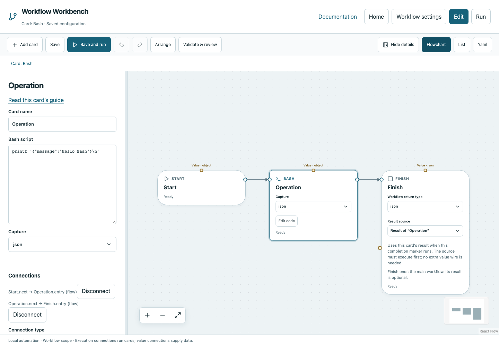

# Bash

Execute inline Bash for shell-oriented automation and capture its result.

## Before you start

Work in **Edit** view in a saved project folder. Start with the downloadable example in its own directory; it includes the surrounding wiring needed for this card. See [connections and values](../values.md) if ports or result sources are unfamiliar.

## Behavior and ports

Bash must be installed on the Workbench host; on Windows that is an additional prerequisite. Advanced **Bash script** runs as a Bash program, while **Capture** selects `text` or `json`.

The result is always an object with `exit_code`, `stdout`, and `stderr`; JSON capture additionally supplies `json`. Stdout in JSON mode must contain exactly one JSON value. Nonzero exit status fails. Stdin receives a serialized object `{"inputs":{...}}`; read it deliberately if needed. Inputs are not expanded into your source automatically. Keep diagnostic messages on stderr when stdout must be JSON.

**Execution outputs:** `next`. **Catalog value contract:** `object`; configuration, declared variables/functions and runtime validation refine the actual type as described above. Inspect the typed return value after running.

## Fields and defaults

| UI field | YAML key | Default | Rules and visibility |
|---|---|---|---|
| Bash script | `code` | `"printf 'Hello workflow\n'"` | Advanced; Required |
| Capture | `capture` | `"text"` | Options: `text`, `json` |

This operation supports resource locks, interactive/exclusive scheduling and a configured timeout. Retry is supported but off by default. Use it only when repeating the operation is safe. See [common execution settings](../settings.md) for field-by-field configuration, cancellation and evidence.

## Configure it in the browser

1. Add Bash and open its advanced Bash script field.
2. Use `printf '{"message":"Hello Bash"}\n'` and select Capture `json`.
3. Connect Start → Bash → Finish and select Bash's result.
4. Save and run; inspect stdout and the parsed `json.message` field.
5. To use the parsed message in another card, choose the Bash result and nested path `json.message`.

## Configured example



*Actual Workbench screenshot from a disposable documentation project. Select the image to enlarge it in the documentation site.*

[Download the complete runnable workflow](../../examples/bash.yaml). Place it in a dedicated folder, add any companion files described above, then use **Home → Add project or file** to open it. It is configured for the current schema; it is not a screenshot-only mockup.

This is the selected card's YAML configuration. The download also includes its Start, completion markers, graph declarations and execution connections:

```yaml
id: operation
kind: bash
name: Operation
config:
  code: printf '{"message":"Hello Bash"}\n'
  capture: json
```

Bindings such as `$ref` in this YAML are represented by named value choices in the browser. They supply values and never start execution. Save your own edits, validate, and compare **Run** evidence with the behavior described above.

## Common mistakes and recovery

`exit 1` fails even if stdout contains valid JSON. Progress/log lines on stdout make JSON capture invalid; use text capture or keep stdout strictly JSON. Quoting is Bash syntax. Do not concatenate untrusted inputs into shell commands; prefer Program arguments for literal values.

If validation reports an issue, click that issue to locate the card on its flowchart. Correct its fields, scope or connections, then Validate again. Check the selected execution's log, attempts and typed result for runtime errors before deliberately rerunning side effects.

## Next example

Use text capture for a test command, or invoke an existing Bash script with Script file.

Continue with [the control-flow tutorials](../tutorials/completion.md), [running and evidence](../running.md), or the [card catalog](index.md).
