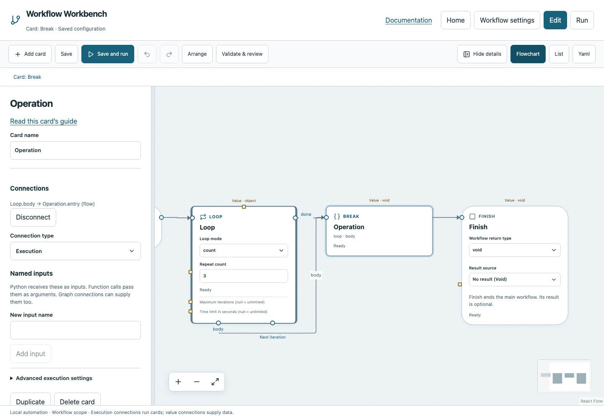

# Break

Exit the nearest enclosing loop early and continue from that loop’s Done output.

## Before you start

Work in **Edit** view in a saved project folder. Start with the downloadable example in its own directory; it includes the surrounding wiring needed for this card. See [connections and values](../values.md) if ports or result sources are unfamiliar.

## Behavior and ports

Break is an execution-only terminal card with no configurable fields or result payload. It succeeds as loop control; it is not an error. It must belong to a loop body, possibly inside another controlled region in that body. In nested loops it exits the nearest one only.

A Break in a called function cannot jump out of the caller's loop. Return completes a function or region; it does not substitute for Break's early loop exit. Try/Finally cleanup runs for a legal Break unless the user stops execution.

**Execution outputs:** None (terminal marker). **Catalog value contract:** `void`; configuration, declared variables/functions and runtime validation refine the actual type as described above. Inspect the typed return value after running.

## Fields and defaults

| UI field | YAML key | Default | Rules and visibility |
|---|---|---|---|
| No operation fields | — | — | Configure its name/connections; see behavior above. |

This operation supports resource locks, interactive/exclusive scheduling and a configured timeout. Automatic retry is not supported for this card; do not attach an operation retry policy. See [common execution settings](../settings.md) for field-by-field configuration, cancellation and evidence.

## Configure it in the browser

1. Open the example in Edit. It contains a Repeat count loop configured for three iterations.
2. Connect Loop.Body to Break. Preserve Break's loop-body ownership.
3. Connect Loop.Done to Finish. Break has no next wire to connect.
4. Save and run. Only one iteration begins before Break exits successfully; the loop result reports one completed body invocation.
5. In a real workflow put If/Else before Break and route the alternative path to the remaining body work.

## Configured example



*Actual Workbench screenshot from a disposable documentation project. Select the image to enlarge it in the documentation site.*

[Download the complete runnable workflow](../../examples/break.yaml). Place it in a dedicated folder, add any companion files described above, then use **Home → Add project or file** to open it. It is configured for the current schema; it is not a screenshot-only mockup.

This is the selected card's YAML configuration. The download also includes its Start, completion markers, graph declarations and execution connections:

```yaml
id: operation
kind: break
name: Operation
config: {}
owner:
  card: loop
  region: body
```

Bindings such as `$ref` in this YAML are represented by named value choices in the browser. They supply values and never start execution. Save your own edits, validate, and compare **Run** evidence with the behavior described above.

## Common mistakes and recovery

Break in main or an unrelated function is invalid. Placing a card visually inside a dotted area does not make it part of a loop. Check the ownership indicator and execution wiring.

If validation reports an issue, click that issue to locate the card on its flowchart. Correct its fields, scope or connections, then Validate again. Check the selected execution's log, attempts and typed result for runtime errors before deliberately rerunning side effects.

## Next example

Exit a test-retry loop after an explicit success condition instead of using failure as the exit signal.

Continue with [the control-flow tutorials](../tutorials/completion.md), [running and evidence](../running.md), or the [card catalog](index.md).
