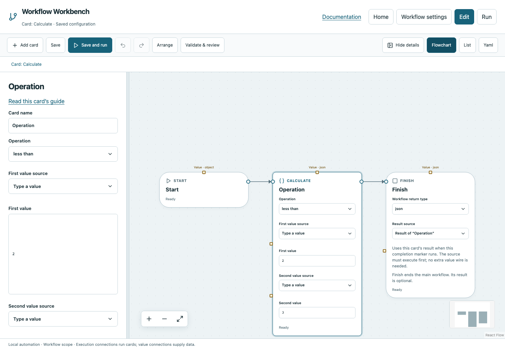

# Calculate

Perform arithmetic, comparisons or Boolean logic without writing a script.

## Before you start

Work in **Edit** view in a saved project folder. Start with the downloadable example in its own directory; it includes the surrounding wiring needed for this card. See [connections and values](../values.md) if ports or result sources are unfamiliar.

## Behavior and ports

**Operation** selects arithmetic `add/subtract/multiply/divide`, equality `equals/not_equals`, numeric `less_than/greater_than`, or Boolean `and/or/not`. **First value** and **Second value** accept constants, declared inputs, or prior card results by name. The second field is hidden for `not`.

Arithmetic and numeric comparisons require finite numbers. Boolean operations require Booleans. Equality compares JSON without string coercion: `1` equals `1.0`, but `false` differs from `0`, including inside arrays and objects. Division by zero fails. Runtime result types are recorded: arithmetic returns a number; comparisons and Boolean operations return Boolean.

**Execution outputs:** `next`. **Catalog value contract:** `json`; configuration, declared variables/functions and runtime validation refine the actual type as described above. Inspect the typed return value after running.

## Fields and defaults

| UI field | YAML key | Default | Rules and visibility |
|---|---|---|---|
| Operation | `operator` | `"add"` | Options: `add`, `subtract`, `multiply`, `divide`, `equals`, `not_equals`, `less_than`, `greater_than`, `and`, `or`, `not` |
| First value | `left` | `0` | Primary setting |
| Second value | `right` | `1` | Hidden when operator = `not` |

This operation supports resource locks, interactive/exclusive scheduling and a configured timeout. Automatic retry is not supported for this card; do not attach an operation retry policy. See [common execution settings](../settings.md) for field-by-field configuration, cancellation and evidence.

## Configure it in the browser

1. Add Calculate between Start and Finish.
2. Choose `less_than`, First value `2`, Second value `3`.
3. On Finish select the Calculate result. Save and run: the result is Boolean `true`.
4. For a variable comparison, place Variable Get count before Calculate and choose **Result of “Get Count”** in First value.
5. Inside a condition function send the comparison to Return and declare that function Boolean.

## Configured example



*Actual Workbench screenshot from a disposable documentation project. Select the image to enlarge it in the documentation site.*

[Download the complete runnable workflow](../../examples/calculate.yaml). Place it in a dedicated folder, add any companion files described above, then use **Home → Add project or file** to open it. It is configured for the current schema; it is not a screenshot-only mockup.

This is the selected card's YAML configuration. The download also includes its Start, completion markers, graph declarations and execution connections:

```yaml
id: operation
kind: calculate
name: Operation
config:
  operator: less_than
  left: 2
  right: 3
```

Bindings such as `$ref` in this YAML are represented by named value choices in the browser. They supply values and never start execution. Save your own edits, validate, and compare **Run** evidence with the behavior described above.

## Common mistakes and recovery

Use the source picker instead of pasting `$ref` JSON. The selected producer must already execute on the path. A number in quotes is text and does not work with less_than. An existing square wire overrides a configured field until you change/remove that binding through the editor.

If validation reports an issue, click that issue to locate the card on its flowchart. Correct its fields, scope or connections, then Validate again. Check the selected execution's log, attempts and typed result for runtime errors before deliberately rerunning side effects.

## Next example

Build a While condition from Get count and less_than, then use If/Else for two distinct continuations.

Continue with [the control-flow tutorials](../tutorials/completion.md), [running and evidence](../running.md), or the [card catalog](index.md).
