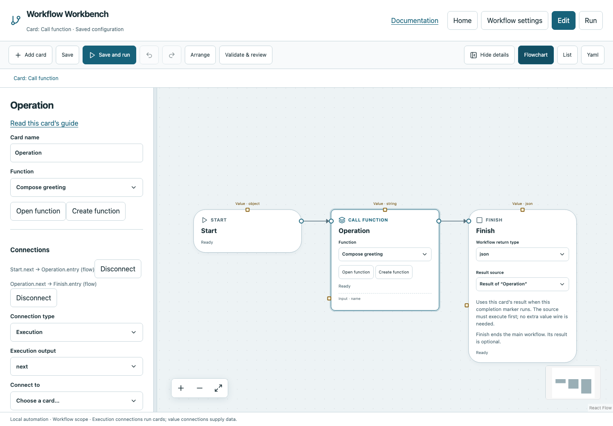

# Call function

Invoke a named reusable function and use its declared typed result.

## Before you start

Work in **Edit** view in a saved project folder. Start with the downloadable example in its own directory; it includes the surrounding wiring needed for this card. See [connections and values](../values.md) if ports or result sources are unfamiliar.

## Behavior and ports

Choose **Function**, then pass arguments in **Named inputs**. A function defines its own input names/types/defaults and return type in a dedicated graph. Each call gets isolated arguments and intermediate card results. Declared run globals remain shared.

Functions must complete their successful paths with Return and are initially nonrecursive. Their Start/Return markers are not main Start/Finish. A value from an earlier invocation is not available unless deliberately passed or stored. Condition selectors on If/While/Poll invoke Boolean functions directly; use Call function for ordinary reusable work.

**Execution outputs:** `next`. **Catalog value contract:** `json`; configuration, declared variables/functions and runtime validation refine the actual type as described above. Inspect the typed return value after running.

## Fields and defaults

| UI field | YAML key | Default | Rules and visibility |
|---|---|---|---|
| Function | `function` | `""` | Required |

This structural card coordinates child work. Configure resources/interactive/exclusive scheduling on its executable operations, not on the container. Automatic retry is not supported for this card; do not attach an operation retry policy. See [common execution settings](../settings.md) for field-by-field configuration, cancellation and evidence.

## Configure it in the browser

1. Create function **Compose greeting** with string return type. In its graph, click empty canvas to show **Function inputs**; add input `name`, choose string and enable **Required without default**.
2. Open it and connect Start → Python → Return. Give Python Named input name from the function input and code `return "Hello " + inputs["name"]`.
3. On Return select the Python result; use Back to caller.
4. Add Call function in main, choose Compose greeting, and pass name `Reader` in Named inputs.
5. Connect Start → Call function → Finish and return its result. Run to obtain `Hello Reader`.

## Configured example



*Actual Workbench screenshot from a disposable documentation project. Select the image to enlarge it in the documentation site.*

[Download the complete runnable workflow](../../examples/call.yaml). Place it in a dedicated folder, add any companion files described above, then use **Home → Add project or file** to open it. It is configured for the current schema; it is not a screenshot-only mockup.

This is the selected card's YAML configuration. The download also includes its Start, completion markers, graph declarations and execution connections:

```yaml
id: operation
kind: call
name: Operation
config:
  function: greet
inputs:
  name: Reader
```

Bindings such as `$ref` in this YAML are represented by named value choices in the browser. They supply values and never start execution. Save your own edits, validate, and compare **Run** evidence with the behavior described above.

## Common mistakes and recovery

Missing required arguments or wrong types fail validation/runtime checking. Function arguments are not automatically forwarded to every operation: bind them on the receiving card. Recursion and Break/Continue into the caller’s loop are unsupported.

If validation reports an issue, click that issue to locate the card on its flowchart. Correct its fields, scope or connections, then Validate again. Check the selected execution's log, attempts and typed result for runtime errors before deliberately rerunning side effects.

## Next example

Call the same function twice with different arguments and inspect independent execution paths and results.

Continue with [the control-flow tutorials](../tutorials/completion.md), [running and evidence](../running.md), or the [card catalog](index.md).
