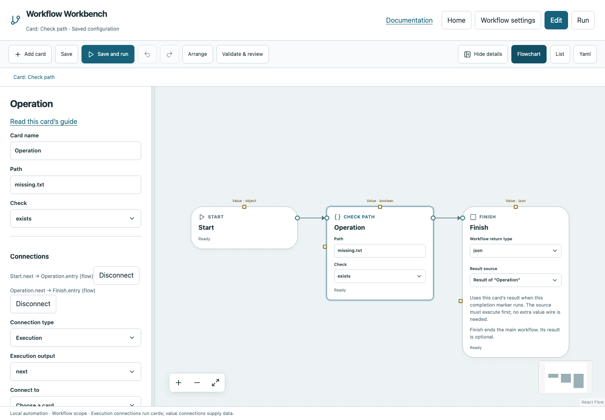

# Check path

Ask whether a path exists, is a regular file or is a directory, returning Boolean.

## Before you start

Work in **Edit** view in a saved project folder. Start with the downloadable example in its own directory; it includes the surrounding wiring needed for this card. See [connections and values](../values.md) if ports or result sources are unfamiliar.

## Behavior and ports

**Path** resolves relative to the workflow folder; **Check** selects `exists`, `file` or `directory`. The default `.` with exists returns True for the workspace itself. A missing path normally returns False successfully, rather than failing the run. Paths and resolved symlink targets must stay inside the project.

Use a function containing Check path → Return for If/Else or Poll until. It does not create the file and does not wait by itself. A false result must be consumed by control flow if you want a different path.

**Execution outputs:** `next`. **Catalog value contract:** `boolean`; configuration, declared variables/functions and runtime validation refine the actual type as described above. Inspect the typed return value after running.

## Fields and defaults

| UI field | YAML key | Default | Rules and visibility |
|---|---|---|---|
| Path | `path` | `"."` | Required |
| Check | `type` | `"exists"` | Options: `exists`, `file`, `directory` |

This operation supports resource locks, interactive/exclusive scheduling and a configured timeout. Retry is supported but off by default. Use it only when repeating the operation is safe. See [common execution settings](../settings.md) for field-by-field configuration, cancellation and evidence.

## Configure it in the browser

1. Add Check path and enter `missing.txt`, Check `exists`.
2. Connect Start → Check path → Finish and choose Check path as Finish's result.
3. Save and run: the workflow passes with Boolean `false`.
4. Create that file inside the project and run again to obtain True.
5. For waiting behavior, put this card inside a Boolean function and select that function on Poll until.

## Configured example



*Actual Workbench screenshot from a disposable documentation project. Select the image to enlarge it in the documentation site.*

[Download the complete runnable workflow](../../examples/check_path.yaml). Place it in a dedicated folder, add any companion files described above, then use **Home → Add project or file** to open it. It is configured for the current schema; it is not a screenshot-only mockup.

This is the selected card's YAML configuration. The download also includes its Start, completion markers, graph declarations and execution connections:

```yaml
id: operation
kind: check_path
name: Operation
config:
  path: missing.txt
  type: exists
```

Bindings such as `$ref` in this YAML are represented by named value choices in the browser. They supply values and never start execution. Save your own edits, validate, and compare **Run** evidence with the behavior described above.

## Common mistakes and recovery

Choosing directory for a file returns False. A path outside the workspace is rejected rather than reported as missing. Checking a file and later opening it are separate operations; the file may change between them.

If validation reports an issue, click that issue to locate the card on its flowchart. Correct its fields, scope or connections, then Validate again. Check the selected execution's log, attempts and typed result for runtime errors before deliberately rerunning side effects.

## Next example

Use the Poll for a file starter to wait until another process produces a ready marker.

Continue with [the control-flow tutorials](../tutorials/completion.md), [running and evidence](../running.md), or the [card catalog](index.md).
