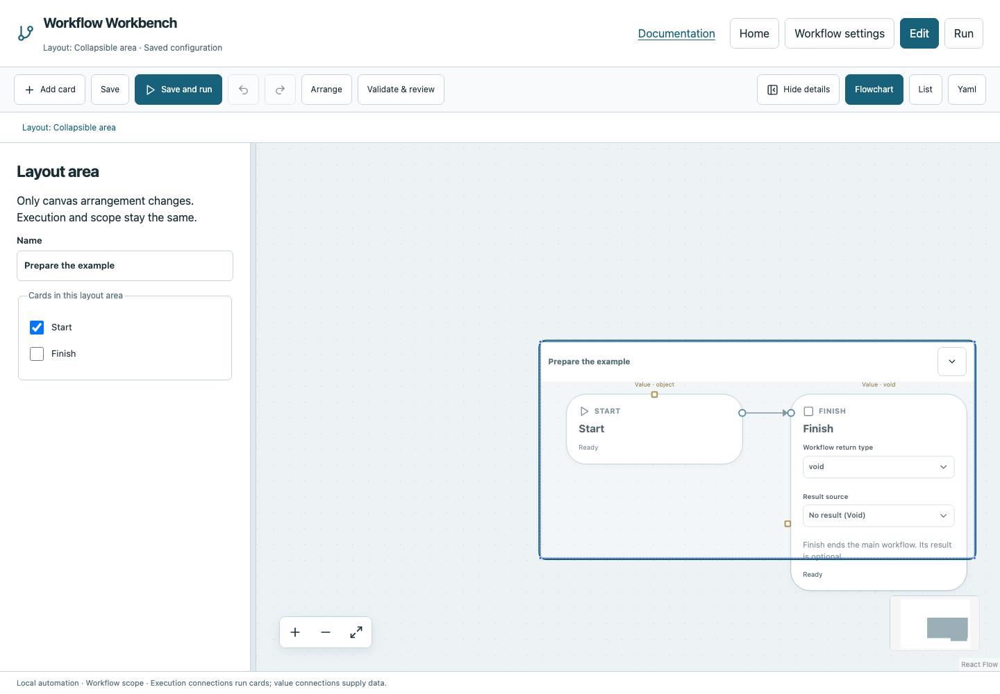

# Collapsible area

A collapsible area can hide member cards to reduce canvas clutter. Expand it before editing hidden members. Hidden cards still execute according to their existing wires and ownership; collapsing is not disabling a task.

## Fields and behavior

Layout metadata stores `id`, `kind`, `name`, `position`, `width`, `height`, `members` and `collapsed`. Position is x/y canvas coordinates. The schema allows width at least 100 and height at least 80; the canvas resize handles use minimum 300 × 150. Members are card IDs. Use the visible label, dimensions and membership controls rather than editing execution ownership.

Layout never changes a card's branch/loop ownership. Removing an area does not remove its cards. A dotted outline around a card is not equivalent to a function, loop, Try region or Parallel branch.

## Use it in the browser

1. Open a workflow in **Edit** and right-click empty canvas space, or choose **Add card**.
2. Choose **Collapsible area** in Layout. Select the area to edit its Name and member checkboxes in the details panel.
3. Drag the boundary resize handles on the canvas, and choose **Cards in this layout area** in the details panel.
4. Toggle collapse/expand to show or hide members.
5. Save. Use Undo/Redo while arranging it. Run the workflow to confirm the same operations and outputs.

## Example and screenshot

[Download the layout example](../../examples/collapsible.yaml). Its Start → Finish workflow returns Void; the area only changes presentation. Inspect `layout.main.areas` in YAML to see the metadata independently of `graphs.main.edges`.

## Common mistakes

Do not draw an area to create a loop body: connect Loop.Body and preserve the explicit owner. Do not collapse a card to skip it. Use execution conditions to select paths. Areas have no typed output and cannot feed a value connection.

See [editing flowcharts](../editing.md), [Loop](loop.md) and [functions](../tutorials/functions.md) for the corresponding execution concepts.
