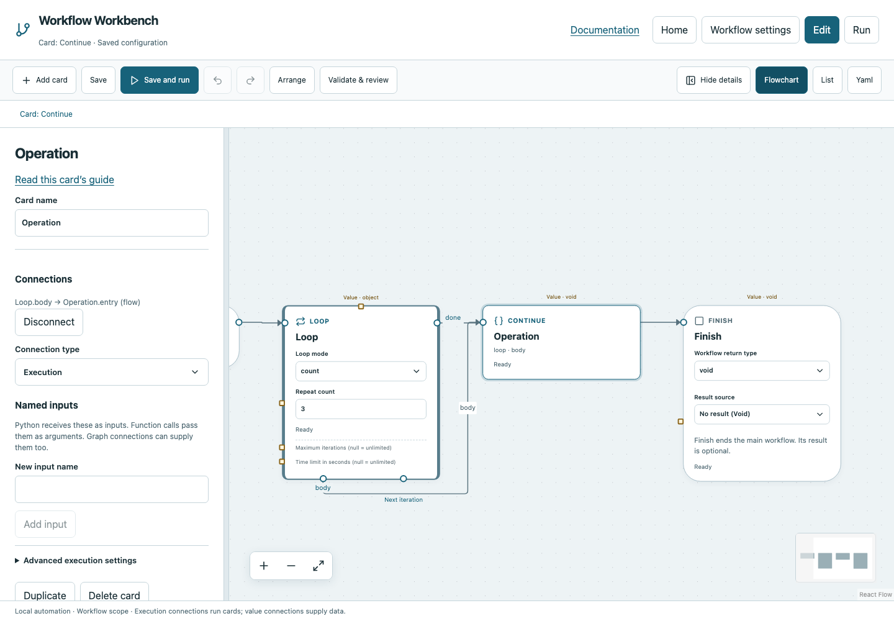

# Continue

Skip the remaining body work and move to the nearest loop’s next iteration check.

## Before you start

Work in **Edit** view in a saved project folder. Start with the downloadable example in its own directory; it includes the surrounding wiring needed for this card. See [connections and values](../values.md) if ports or result sources are unfamiliar.

## Behavior and ports

Continue has an execution Entry, no next output and no configurable operation fields. Count mode advances its iteration; While reevaluates its Boolean function. Continue is successful control flow, not a failed command. Use it inside an owned loop body.

Unlike Break, Continue does not use Done immediately. A While condition that remains true can repeat forever when Continue skips the state update, so design that path deliberately. Configured bounds still apply.

**Execution outputs:** None (terminal marker). **Catalog value contract:** `void`; configuration, declared variables/functions and runtime validation refine the actual type as described above. Inspect the typed return value after running.

## Fields and defaults

| UI field | YAML key | Default | Rules and visibility |
|---|---|---|---|
| No operation fields | — | — | Configure its name/connections; see behavior above. |

This operation supports resource locks, interactive/exclusive scheduling and a configured timeout. Automatic retry is not supported for this card; do not attach an operation retry policy. See [common execution settings](../settings.md) for field-by-field configuration, cancellation and evidence.

## Configure it in the browser

1. Open the Continue example: Start → Repeat count loop, Body → Continue, Done → Finish.
2. Inspect the count `3`; run and observe three body invocations.
3. To use a conditional skip, insert If/Else inside the body and connect one branch to Continue.
4. Wire the other branch through useful work and back to Next iteration.
5. Validate the complete graph and inspect iteration paths in Run view.

## Configured example



*Actual Workbench screenshot from a disposable documentation project. Select the image to enlarge it in the documentation site.*

[Download the complete runnable workflow](../../examples/continue.yaml). Place it in a dedicated folder, add any companion files described above, then use **Home → Add project or file** to open it. It is configured for the current schema; it is not a screenshot-only mockup.

This is the selected card's YAML configuration. The download also includes its Start, completion markers, graph declarations and execution connections:

```yaml
id: operation
kind: continue
name: Operation
config: {}
owner:
  card: loop
  region: body
```

Bindings such as `$ref` in this YAML are represented by named value choices in the browser. They supply values and never start execution. Save your own edits, validate, and compare **Run** evidence with the behavior described above.

## Common mistakes and recovery

Continue outside a loop fails validation. It cannot target a named outer loop or cross a function boundary. Ensure state changes needed by a While condition occur even on the Continue path.

If validation reports an issue, click that issue to locate the card on its flowchart. Correct its fields, scope or connections, then Validate again. Check the selected execution's log, attempts and typed result for runtime errors before deliberately rerunning side effects.

## Next example

Skip optional work for one iteration while retaining the rest of a bounded test workflow.

Continue with [the control-flow tutorials](../tutorials/completion.md), [running and evidence](../running.md), or the [card catalog](index.md).
