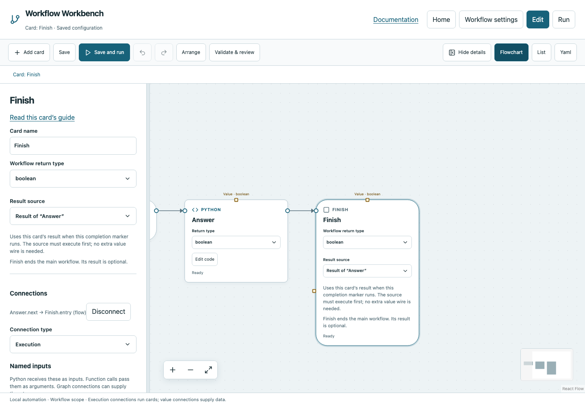

# Finish

End the main workflow successfully, optionally publishing a typed result to its caller.

## Before you start

Work in **Edit** view in a saved project folder. Start with the downloadable example in its own directory; it includes the surrounding wiring needed for this card. See [connections and values](../values.md) if ports or result sources are unfamiliar.

## Behavior and ports

Finish is the completion marker for the main graph. It has an execution Entry and no next execution output. Every successful main path must eventually reach a Finish. Different If paths may converge on the same Finish.

The default **Workflow return type** is `void`: the workflow succeeds without returning data. A value of `null` is different: select `null` if you intentionally return JSON null. A returned Boolean `false` is still successful.

The round execution wire determines when Finish runs. **Result source** determines what it returns. Select a prior Python or Calculate card by name. A square value wire is an alternative; neither method replaces the execution wire.

**Execution outputs:** None (terminal marker). **Catalog value contract:** `json`; configuration, declared variables/functions and runtime validation refine the actual type as described above. Inspect the typed return value after running.

## Fields and defaults

| UI field | YAML key | Default | Rules and visibility |
|---|---|---|---|
| Workflow return type | `returns` | `"void"` | Primary setting |
| Workflow output | `value` | `null` | Primary setting |

This operation supports resource locks, interactive/exclusive scheduling and a configured timeout. Automatic retry is not supported for this card; do not attach an operation retry policy. See [common execution settings](../settings.md) for field-by-field configuration, cancellation and evidence.

## Configure it in the browser

1. Add your operation between Start and Finish and connect both round execution wires.
2. Select Finish. For a side-effect-only task choose **No result (Void)**.
3. To return data, choose the producer under **Result source**, or choose **Type a value** and a compatible return type.
4. **Validate & review** and **Save**. An execution wire alone does not resolve an empty typed result.
5. Run the example. Python returns False and Finish publishes a successful Boolean `false` in the run result.

## Configured example



*Actual Workbench screenshot from a disposable documentation project. Select the image to enlarge it in the documentation site.*

[Download the complete runnable workflow](../../examples/finish.yaml). Place it in a dedicated folder, add any companion files described above, then use **Home → Add project or file** to open it. It is configured for the current schema; it is not a screenshot-only mockup.

This is the selected card's YAML configuration. The download also includes its Start, completion markers, graph declarations and execution connections:

```yaml
id: finish
kind: finish
name: Finish
config:
  returns: boolean
  value:
    $ref: card:answer
```

Bindings such as `$ref` in this YAML are represented by named value choices in the browser. They supply values and never start execution. Save your own edits, validate, and compare **Run** evidence with the behavior described above.

## Common mistakes and recovery

“Expected boolean; received null” means a typed result is missing, not that the execution wire is disconnected. Select a result source. Finish cannot be used inside a function or controlled branch; use Return there. A result source must have executed on every path reaching this Finish.

If validation reports an issue, click that issue to locate the card on its flowchart. Correct its fields, scope or connections, then Validate again. Check the selected execution's log, attempts and typed result for runtime errors before deliberately rerunning side effects.

## Next example

Use Finish to publish a child workflow result that an External workspace card consumes.

Continue with [the control-flow tutorials](../tutorials/completion.md), [running and evidence](../running.md), or the [card catalog](index.md).
