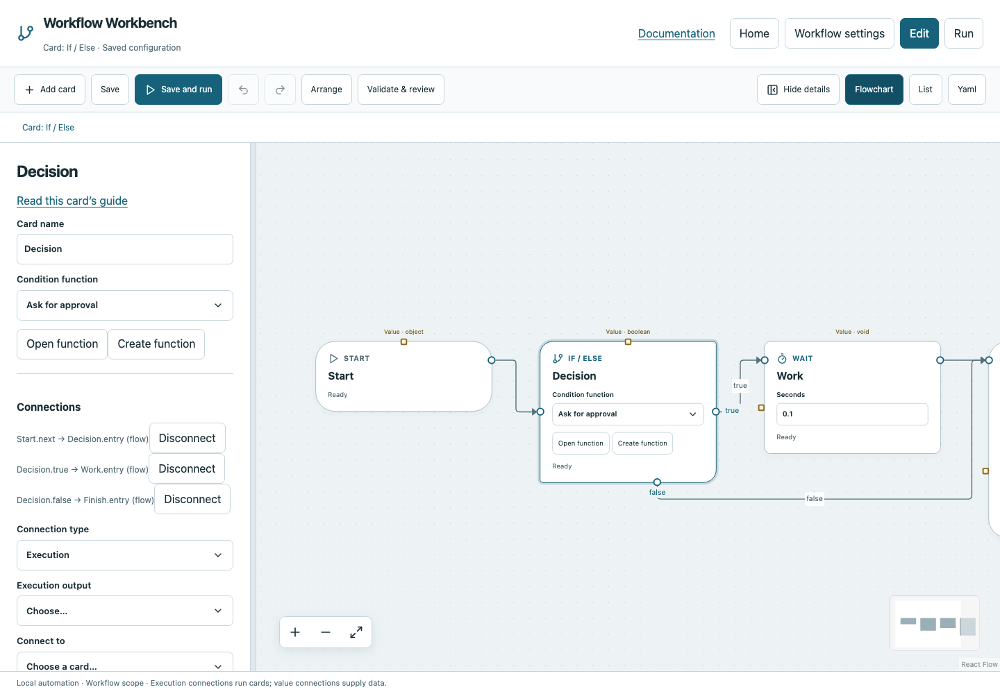

# If / Else

Choose exactly one of two paths using a reusable Boolean function.

## Before you start

Work in **Edit** view in a saved project folder. Start with the downloadable example in its own directory; it includes the surrounding wiring needed for this card. See [connections and values](../values.md) if ports or result sources are unfamiliar.

## Behavior and ports

If/Else has one Entry and two execution outputs: `true` and `false`. Both paths need a valid continuation, even if they later converge. Only the selected path executes. The card invokes the chosen function each time and records its Boolean result.

Its **Condition function** must declare a Boolean return type. Use **Create function** when you need one, or **Open function** to edit it. Pass arguments using **Named inputs**. Function operations compute the answer, then Return sends it back to If. A value wire alone is not a condition function.

**Execution outputs:** `true`, `false`. **Catalog value contract:** `boolean`; configuration, declared variables/functions and runtime validation refine the actual type as described above. Inspect the typed return value after running.

## Fields and defaults

| UI field | YAML key | Default | Rules and visibility |
|---|---|---|---|
| Condition function | `function` | `""` | Required; Function returns boolean |

This structural card coordinates child work. Configure resources/interactive/exclusive scheduling on its executable operations, not on the container. Automatic retry is not supported for this card; do not attach an operation retry policy. See [common execution settings](../settings.md) for field-by-field configuration, cancellation and evidence.

## Configure it in the browser

1. Add **If / Else** and connect Start to its Entry.
2. Use **Condition function → Create function**; keep its return type Boolean.
3. In that function connect Start → Python → Return. Enter `return True` and set Python's return type to Boolean.
4. On Return choose the Python result. Use **Back to caller**.
5. Connect If's True port to work and False port to Finish; connect work to Finish. Save and run.
6. Change Python to `return False` and run again. Work is skipped; Finish still passes.

## Configured example



*Actual Workbench screenshot from a disposable documentation project. Select the image to enlarge it in the documentation site.*

[Download the complete runnable workflow](../../examples/if.yaml). Place it in a dedicated folder, add any companion files described above, then use **Home → Add project or file** to open it. It is configured for the current schema; it is not a screenshot-only mockup.

This is the selected card's YAML configuration. The download also includes its Start, completion markers, graph declarations and execution connections:

```yaml
id: decision
kind: if
name: Decision
config:
  function: approved
```

Bindings such as `$ref` in this YAML are represented by named value choices in the browser. They supply values and never start execution. Save your own edits, validate, and compare **Run** evidence with the behavior described above.

## Common mistakes and recovery

A condition returning `"false"` is a string and fails type checking. Missing False wiring is invalid even when the current condition always returns True. If does not fan out concurrently; use Parallel for that.

If validation reports an issue, click that issue to locate the card on its flowchart. Correct its fields, scope or connections, then Validate again. Check the selected execution's log, attempts and typed result for runtime errors before deliberately rerunning side effects.

## Next example

Replace Python in the condition with Check path, Calculate, or Manual decision and return that card’s Boolean result.

Continue with [the control-flow tutorials](../tutorials/completion.md), [running and evidence](../running.md), or the [card catalog](index.md).
