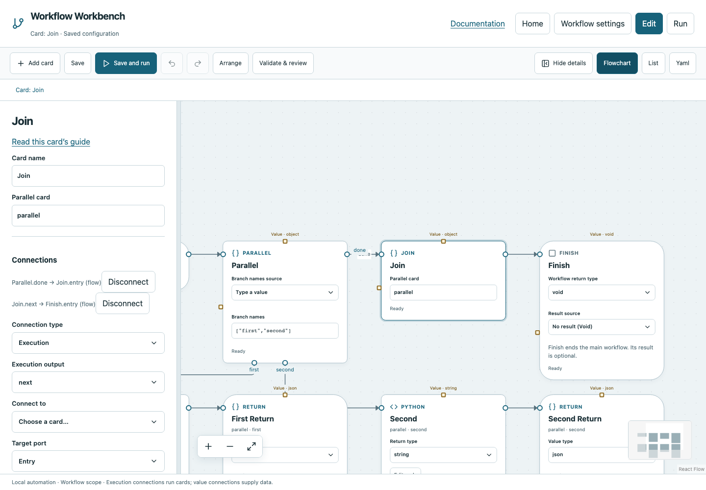

# Join

Expose the named results produced by a specific Parallel card after its branches finish.

## Before you start

Work in **Edit** view in a saved project folder. Start with the downloadable example in its own directory; it includes the surrounding wiring needed for this card. See [connections and values](../values.md) if ports or result sources are unfamiliar.

## Behavior and ports

Join is paired with Parallel, not a general merge of arbitrary incoming execution wires. Its **Parallel card** field contains that card's stable ID; the editor configures it when adding Parallel. Entry receives Parallel.Done, then `next` continues normally.

A typical result is `{"first":{"type":"string","value":"first completed"},"second":{"type":"string","value":"second completed"}}`. To read the first string, choose Join as a result source and select nested path `first.value`. Join does not combine or overwrite globals.

**Execution outputs:** `next`. **Catalog value contract:** `object`; configuration, declared variables/functions and runtime validation refine the actual type as described above. Inspect the typed return value after running.

## Fields and defaults

| UI field | YAML key | Default | Rules and visibility |
|---|---|---|---|
| Parallel card | `parallel` | `""` | Required |

This operation supports resource locks, interactive/exclusive scheduling and a configured timeout. Automatic retry is not supported for this card; do not attach an operation retry policy. See [common execution settings](../settings.md) for field-by-field configuration, cancellation and evidence.

## Configure it in the browser

1. Add Parallel and inspect its automatically created Join.
2. Complete both branches with Return markers.
3. Keep the Join's Parallel card reference unchanged unless intentionally repairing a pair.
4. Connect Join.next to Finish or another operation.
5. Run the example and expand Join's typed returned value. Use a nested path to pass one branch's value onward.

## Configured example



*Actual Workbench screenshot from a disposable documentation project. Select the image to enlarge it in the documentation site.*

[Download the complete runnable workflow](../../examples/join.yaml). Place it in a dedicated folder, add any companion files described above, then use **Home → Add project or file** to open it. It is configured for the current schema; it is not a screenshot-only mockup.

This is the selected card's YAML configuration. The download also includes its Start, completion markers, graph declarations and execution connections:

```yaml
id: join
kind: join
name: Join
config:
  parallel: parallel
```

Bindings such as `$ref` in this YAML are represented by named value choices in the browser. They supply values and never start execution. Save your own edits, validate, and compare **Run** evidence with the behavior described above.

## Common mistakes and recovery

A Join referencing a missing/wrong Parallel is invalid. Connecting branches directly to Join instead of completing their owned regions is not the supported pattern. Branch values are nested typed records, not a flattened dictionary.

If validation reports an issue, click that issue to locate the card on its flowchart. Correct its fields, scope or connections, then Validate again. Check the selected execution's log, attempts and typed result for runtime errors before deliberately rerunning side effects.

## Next example

Use Calculate/Python after Join to evaluate named test outcomes while keeping each branch’s evidence separate.

Continue with [the control-flow tutorials](../tutorials/completion.md), [running and evidence](../running.md), or the [card catalog](index.md).
