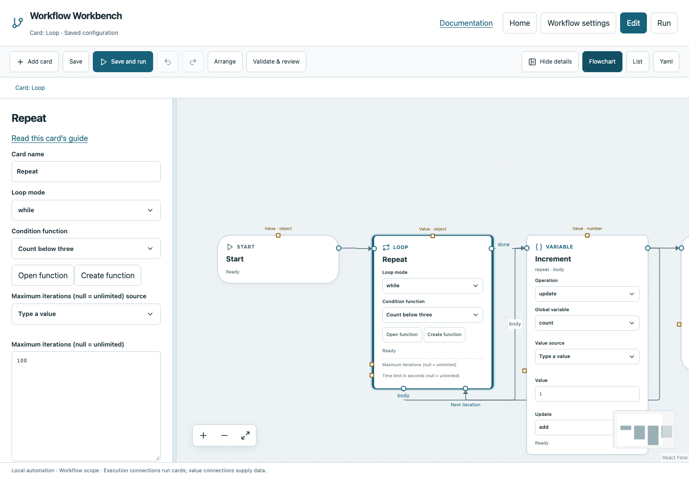

# Loop

Repeat a connected body a fixed number of times or while a Boolean function returns True.

## Before you start

Work in **Edit** view in a saved project folder. Start with the downloadable example in its own directory; it includes the surrounding wiring needed for this card. See [connections and values](../values.md) if ports or result sources are unfamiliar.

## Behavior and ports

The four ports have different jobs: **Entry** starts the loop; **Body** starts one iteration; **Next iteration** receives the body's final execution wire; **Done** continues after exit. Body cards are explicitly owned by the loop, not merely drawn nearby.

In `count` mode, **Repeat count** must be a nonnegative integer; zero skips the body. In `while` mode, **Condition function** is called before every iteration. False exits before the first body execution or after a later condition check. Update something the condition reads; otherwise a true condition never changes.

Advanced **Maximum iterations** defaults to 100 and **Time limit** to 1,800 seconds. Each accepts JSON `null` for unlimited. Reaching a configured bound fails with a reason. The returned object contains `iterations`. `loop.index` starts at zero; `loop.iteration` starts at one. Nested loops maintain independent iteration state.

**Execution outputs:** `body`, `done`. **Catalog value contract:** `object`; configuration, declared variables/functions and runtime validation refine the actual type as described above. Inspect the typed return value after running.

## Fields and defaults

| UI field | YAML key | Default | Rules and visibility |
|---|---|---|---|
| Loop mode | `mode` | `"count"` | Options: `count`, `while` |
| Repeat count | `count` | `3` | Shown when mode = `count` |
| Condition function | `function` | `""` | Shown when mode = `while`; Function returns boolean |
| Maximum iterations (null = unlimited) | `limit` | `100` | Advanced |
| Time limit in seconds (null = unlimited) | `timeout` | `1800` | Advanced |

This structural card coordinates child work. Configure resources/interactive/exclusive scheduling on its executable operations, not on the container. Automatic retry is not supported for this card; do not attach an operation retry policy. See [common execution settings](../settings.md) for field-by-field configuration, cancellation and evidence.

## Configure it in the browser

1. Declare numeric global `count` with initial value `0` in **Workflow settings**.
2. Create Boolean function **Count below three**: Start → Variable Get count → Calculate less_than 3 → Return.
3. In main choose Loop mode `while` and that function. Connect Start → Loop.Entry.
4. Connect Loop.Body → Variable Update count by add 1 → Loop.Next iteration.
5. Connect Loop.Done → Finish. Save and run; count reaches 3 after three iterations and four condition evaluations.
6. Try the [Repeat count example](../../examples/repeat-count.yaml): use mode `count`, count `3`, and a Wait body. No condition function is needed.

## Configured example



*Actual Workbench screenshot from a disposable documentation project. Select the image to enlarge it in the documentation site.*

[Download the complete runnable workflow](../../examples/loop.yaml). Place it in a dedicated folder, add any companion files described above, then use **Home → Add project or file** to open it. It is configured for the current schema; it is not a screenshot-only mockup.

This is the selected card's YAML configuration. The download also includes its Start, completion markers, graph declarations and execution connections:

```yaml
id: repeat
kind: loop
name: Repeat
config:
  mode: while
  function: below-limit
```

Bindings such as `$ref` in this YAML are represented by named value choices in the browser. They supply values and never start execution. Save your own edits, validate, and compare **Run** evidence with the behavior described above.

## Common mistakes and recovery

Do not connect a normal card back to an arbitrary earlier card. Only a legal owned body may connect to Next iteration. A missing body return wire leaves the region incomplete. A function cannot Break/Continue its caller’s loop. Intermediate body results do not automatically become values outside the loop; publish deliberate state using globals.

If validation reports an issue, click that issue to locate the card on its flowchart. Correct its fields, scope or connections, then Validate again. Check the selected execution's log, attempts and typed result for runtime errors before deliberately rerunning side effects.

## Next example

Use Break for early success, Continue to skip the rest of an iteration, and a nested Loop only when two independent repetitions are required.

Continue with [the control-flow tutorials](../tutorials/completion.md), [running and evidence](../running.md), or the [card catalog](index.md).
