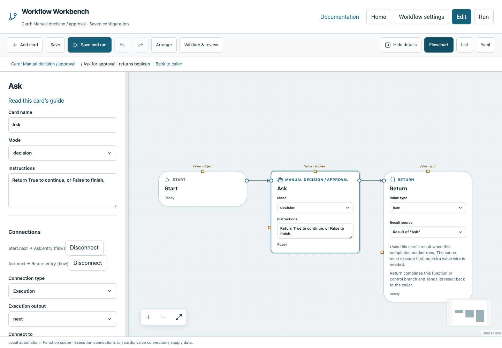

# Manual decision / approval

Ask a human to record evidence and optionally return True or False.

## Before you start

Work in **Edit** view in a saved project folder. Start with the downloadable example in its own directory; it includes the surrounding wiring needed for this card. See [connections and values](../values.md) if ports or result sources are unfamiliar.

## Behavior and ports

Mode `decision` asks for notes and a Boolean choice. Mode `approval` requires evidence notes and returns Void. The prompt appears in the browser during execution; each invocation needs its own answer, including repeated function calls or loop iterations.

The result of a negative decision is Boolean False, not an execution failure. To branch, put the Manual decision in a Boolean function, return its value, and select that function on If/Else. Approval mode records completion but cannot satisfy a Boolean condition. Noninteractive CLI runs remain blocked instead of approving automatically.

**Execution outputs:** `next`. **Catalog value contract:** `json`; configuration, declared variables/functions and runtime validation refine the actual type as described above. Inspect the typed return value after running.

## Fields and defaults

| UI field | YAML key | Default | Rules and visibility |
|---|---|---|---|
| Mode | `mode` | `"decision"` | Options: `decision`, `approval` |
| Instructions | `instructions` | `"Record what you checked."` | Primary setting |

This operation supports resource locks, interactive/exclusive scheduling and a configured timeout. Automatic retry is not supported for this card; do not attach an operation retry policy. See [common execution settings](../settings.md) for field-by-field configuration, cancellation and evidence.

## Configure it in the browser

1. Open the manual example and inspect its **Ask for approval** function.
2. Set Mode `decision` and write Instructions describing what the operator should check.
3. Keep Manual → Return connected and choose the Manual result on Return.
4. Run in the browser. Enter evidence notes and select True or False in the prompt.
5. True follows the work path; False skips it and finishes successfully. Run again to confirm a new prompt is required.

## Configured example



*Actual Workbench screenshot from a disposable documentation project. Select the image to enlarge it in the documentation site.*

[Download the complete runnable workflow](../../examples/manual.yaml). Place it in a dedicated folder, add any companion files described above, then use **Home → Add project or file** to open it. It is configured for the current schema; it is not a screenshot-only mockup.

This is the selected card's YAML configuration. The download also includes its Start, completion markers, graph declarations and execution connections:

```yaml
id: ask
kind: manual
name: Ask
config:
  mode: decision
  instructions: Return True to continue, or False to finish.
```

Bindings such as `$ref` in this YAML are represented by named value choices in the browser. They supply values and never start execution. Save your own edits, validate, and compare **Run** evidence with the behavior described above.

## Common mistakes and recovery

Blank notes cannot complete the intervention. A previous run's answer does not approve a new run. Use the prompt's current execution path when several manual operations are pending. Stop cancels the waiting run. Headless runs cannot fabricate evidence.

If validation reports an issue, click that issue to locate the card on its flowchart. Correct its fields, scope or connections, then Validate again. Check the selected execution's log, attempts and typed result for runtime errors before deliberately rerunning side effects.

## Next example

Use approval for a documented human check that does not need a branch, or decision for an explicit If/Else.

Continue with [the control-flow tutorials](../tutorials/completion.md), [running and evidence](../running.md), or the [card catalog](index.md).
