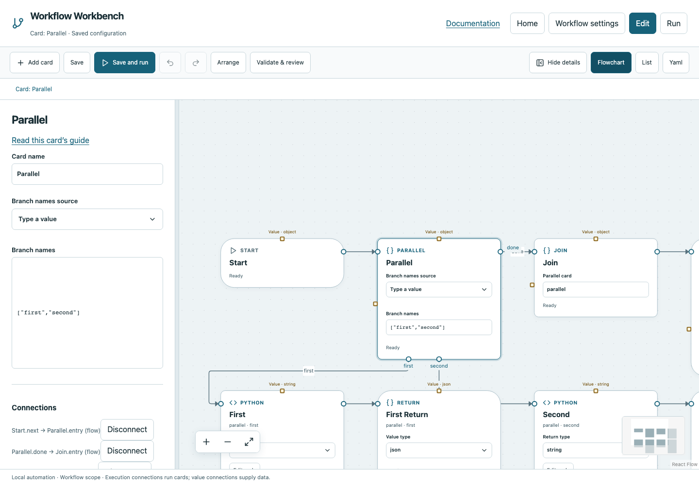

# Parallel

Start two or more named branches concurrently and collect their completion before proceeding.

## Before you start

Work in **Edit** view in a saved project folder. Start with the downloadable example in its own directory; it includes the surrounding wiring needed for this card. See [connections and values](../values.md) if ports or result sources are unfamiliar.

## Behavior and ports

Adding Parallel also creates a matching Join connected from Done. **Branch names** is an array of at least two unique nonempty names, excluding `done`. Each named execution port starts its own owned branch. End each branch with its own Return marker publishing that branch's output.

Branches share the workflow's operation budget, default four. Resources can serialize particular operations; exclusive operations wait for all others. Do not put resource locks on Parallel itself. Its returned object contains named typed results, and matching Join exposes them to downstream work.

**Execution outputs:** `first`, `second`, `done`. **Catalog value contract:** `object`; configuration, declared variables/functions and runtime validation refine the actual type as described above. Inspect the typed return value after running.

## Fields and defaults

| UI field | YAML key | Default | Rules and visibility |
|---|---|---|---|
| Branch names | `branches` | `["first", "second"]` | Primary setting |

This structural card coordinates child work. Configure resources/interactive/exclusive scheduling on its executable operations, not on the container. Automatic retry is not supported for this card; do not attach an operation retry policy. See [common execution settings](../settings.md) for field-by-field configuration, cancellation and evidence.

## Configure it in the browser

1. Add Parallel; keep the automatically created Join.
2. Leave branch names `["first", "second"]` or choose meaningful names such as `lint` and `tests`.
3. Connect each branch port to its work, then to a Return in that branch. Select that work's result on Return.
4. Keep Parallel.Done → Join → Finish connected. Select Join on Finish to publish the collection if wanted.
5. Save and run. Inspect both branch execution paths and the Join result.
6. If you rename a branch, reconnect its affected port and validate before running.

## Configured example



*Actual Workbench screenshot from a disposable documentation project. Select the image to enlarge it in the documentation site.*

[Download the complete runnable workflow](../../examples/parallel.yaml). Place it in a dedicated folder, add any companion files described above, then use **Home → Add project or file** to open it. It is configured for the current schema; it is not a screenshot-only mockup.

This is the selected card's YAML configuration. The download also includes its Start, completion markers, graph declarations and execution connections:

```yaml
id: parallel
kind: parallel
name: Parallel
config:
  branches:
    - first
    - second
```

Bindings such as `$ref` in this YAML are represented by named value choices in the browser. They supply values and never start execution. Save your own edits, validate, and compare **Run** evidence with the behavior described above.

## Common mistakes and recovery

Do not connect one ordinary next output to two cards. A failed branch prevents a successful Join, although an independent branch may finish collecting evidence. Global read/write conflicts must be removed or sequenced. A missing branch Return leaves the branch incomplete.

If validation reports an issue, click that issue to locate the card on its flowchart. Correct its fields, scope or connections, then Validate again. Check the selected execution's log, attempts and typed result for runtime errors before deliberately rerunning side effects.

## Next example

Run independent quality commands in separate branches, each returning its own report summary.

Continue with [the control-flow tutorials](../tutorials/completion.md), [running and evidence](../running.md), or the [card catalog](index.md).
