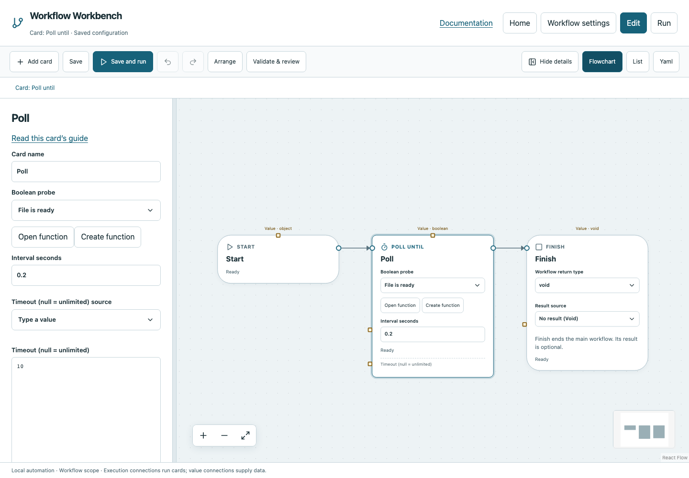

# Poll until

Repeat a Boolean probe function until it returns True, with an interval and optional overall timeout.

## Before you start

Work in **Edit** view in a saved project folder. Start with the downloadable example in its own directory; it includes the surrounding wiring needed for this card. See [connections and values](../values.md) if ports or result sources are unfamiliar.

## Behavior and ports

**Boolean probe** selects a function declared Boolean. Poll invokes it afresh for every probe, records the answer and, on False, waits **Interval seconds** before another call. It returns True when ready. A failed probe fails the card; it is not silently converted to False.

Advanced **Timeout** defaults to 1,800 seconds and accepts JSON `null` for unlimited waiting. Interval must be nonnegative. Stop cancels both the active probe and the interval wait. Unlike While, Poll has no main-canvas body: put the readiness computation inside its function.

**Execution outputs:** `next`. **Catalog value contract:** `boolean`; configuration, declared variables/functions and runtime validation refine the actual type as described above. Inspect the typed return value after running.

## Fields and defaults

| UI field | YAML key | Default | Rules and visibility |
|---|---|---|---|
| Boolean probe | `function` | `""` | Required; Function returns boolean |
| Interval seconds | `interval` | `1` | Primary setting |
| Timeout (null = unlimited) | `timeout` | `1800` | Advanced |

This structural card coordinates child work. Configure resources/interactive/exclusive scheduling on its executable operations, not on the container. Automatic retry is not supported for this card; do not attach an operation retry policy. See [common execution settings](../settings.md) for field-by-field configuration, cancellation and evidence.

## Configure it in the browser

1. Open Poll for a file or the dedicated Poll example.
2. Open the **File is ready** function and inspect Start → Check path ready.txt → Return Boolean.
3. In main select that function on Poll until, interval `0.2`, timeout `10`.
4. Save and run. While it waits, create `ready.txt` in the workflow's project directory.
5. Inspect the repeated False probes followed by True and a successful Finish. Delete ready.txt before repeating the waiting demonstration.

## Configured example



*Actual Workbench screenshot from a disposable documentation project. Select the image to enlarge it in the documentation site.*

[Download the complete runnable workflow](../../examples/poll.yaml). Place it in a dedicated folder, add any companion files described above, then use **Home → Add project or file** to open it. It is configured for the current schema; it is not a screenshot-only mockup.

This is the selected card's YAML configuration. The download also includes its Start, completion markers, graph declarations and execution connections:

```yaml
id: poll
kind: poll
name: Poll
config:
  function: ready
  interval: 0.2
  timeout: 10
```

Bindings such as `$ref` in this YAML are represented by named value choices in the browser. They supply values and never start execution. Save your own edits, validate, and compare **Run** evidence with the behavior described above.

## Common mistakes and recovery

Creating the file in the storage folder rather than the workflow folder does not satisfy the probe. A probe must return Boolean, not `"ready"`. A timeout is a failure with evidence, not a successful False result. Unlimited waits show elapsed time, not a fabricated completion percentage.

If validation reports an issue, click that issue to locate the card on its flowchart. Correct its fields, scope or connections, then Validate again. Check the selected execution's log, attempts and typed result for runtime errors before deliberately rerunning side effects.

## Next example

Probe a local service using Python/HTTP and return a calculated Boolean, keeping each readiness attempt visible.

Continue with [the control-flow tutorials](../tutorials/completion.md), [running and evidence](../running.md), or the [card catalog](index.md).
