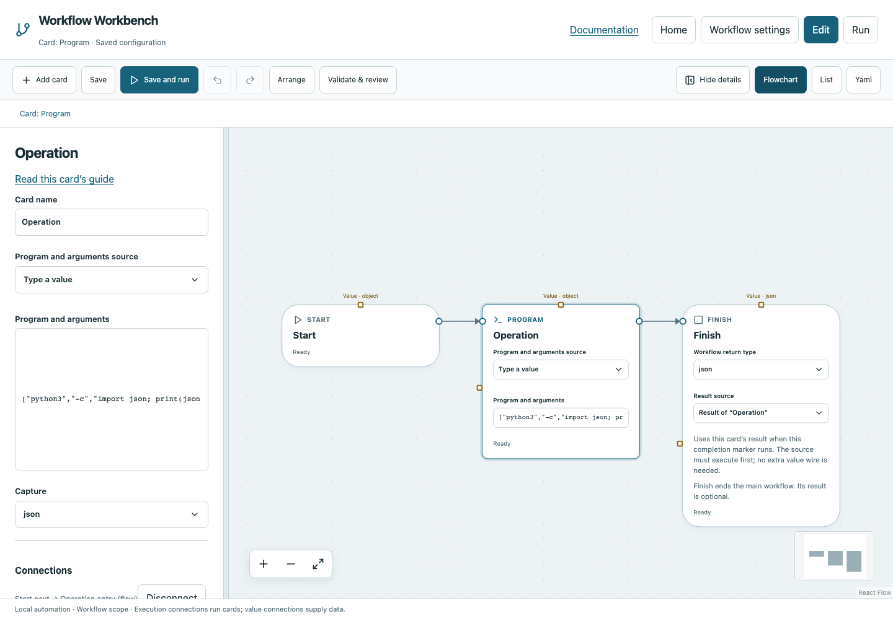

# Program

Run an executable with literal arguments, without invoking a shell.

## Before you start

Work in **Edit** view in a saved project folder. Start with the downloadable example in its own directory; it includes the surrounding wiring needed for this card. See [connections and values](../values.md) if ports or result sources are unfamiliar.

## Behavior and ports

**Program and arguments** is a nonempty string array: first the executable, then each argument. Executables resolve through PATH unless given an explicit path. There is no shell expansion: `&&`, pipes, `$NAME`, wildcards and quoted command-line fragments are literal arguments.

Use advanced **Capture** `text` or `json`. The returned object contains exit_code/stdout/stderr, and `json` for JSON capture. Nonzero status fails. Full stdout/stderr stream to disk logs; each returned stream retains only its last 512 KiB. The result also contains `truncated`, `stdout_truncated`, `stderr_truncated` and per-stream `output_bytes`. Large logs alone do not fail the command. JSON capture rejects truncated stdout; large stderr does not invalidate intact stdout JSON. Set cwd, environment and timeout in execution settings. Named inputs are serialized to stdin.

**Execution outputs:** `next`. **Catalog value contract:** `object`; configuration, declared variables/functions and runtime validation refine the actual type as described above. Inspect the typed return value after running.

## Fields and defaults

| UI field | YAML key | Default | Rules and visibility |
|---|---|---|---|
| Program and arguments | `argv` | `["python3", "--version"]` | Required; Each item is a string or a reference resolving to a string |
| Capture | `capture` | `"text"` | Advanced; Options: `text`, `json` |

This operation supports resource locks, interactive/exclusive scheduling and a configured timeout. Retry is supported but off by default. Use it only when repeating the operation is safe. See [common execution settings](../settings.md) for field-by-field configuration, cancellation and evidence.

## Configure it in the browser

1. Add Program and set arguments to `["python3", "-c", "print(42)"]`.
2. Choose text capture or, because `42` is valid JSON, JSON capture.
3. Choose **Use Workbench Python** to use the running engine's interpreter via `{$ref: "runtime:python"}`, or supply your project's interpreter path. Workbench Python does not install project dependencies. Each argument can also be a typed reference resolving to a string.
4. Connect Start → Program → Finish. Select Program's result and run.
5. Inspect exit_code `0` and stdout `42`; JSON capture includes number `42` under json.

## Configured example



*Actual Workbench screenshot from a disposable documentation project. Select the image to enlarge it in the documentation site.*

[Download the complete runnable workflow](../../examples/program.yaml). Place it in a dedicated folder, add any companion files described above, then use **Home → Add project or file** to open it. It is configured for the current schema; it is not a screenshot-only mockup.

This is the selected card's YAML configuration. The download also includes its Start, completion markers, graph declarations and execution connections:

```yaml
id: operation
kind: program
name: Operation
config:
  argv:
    - python3
    - -c
    - 'import json; print(json.dumps({"message": "Hello program"}))'
  capture: json
```

Bindings such as `$ref` in this YAML are represented by named value choices in the browser. They supply values and never start execution. Save your own edits, validate, and compare **Run** evidence with the behavior described above.

## Common mistakes and recovery

`["python3 --version"]` searches for an executable with a space in its name and fails. Enter separate array elements. Use Bash when shell features are intentional. Executable availability and permissions are host-specific; reviewed Windows syntax does not imply native acceptance.

If validation reports an issue, click that issue to locate the card on its flowchart. Correct its fields, scope or connections, then Validate again. Check the selected execution's log, attempts and typed result for runtime errors before deliberately rerunning side effects.

## Next example

Run a project test runner with explicit argument boundaries and return a concise summary through Python.

Continue with [the control-flow tutorials](../tutorials/completion.md), [running and evidence](../running.md), or the [card catalog](index.md).
