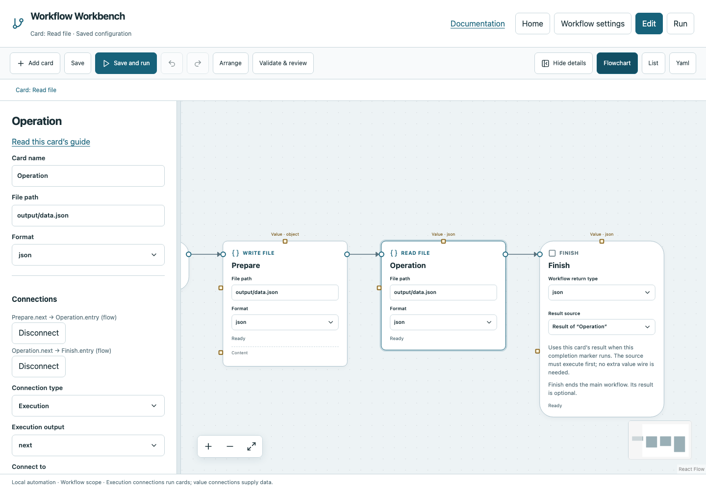

# Read file

Read a bounded local file as UTF-8 text or parsed JSON.

## Before you start

Work in **Edit** view in a saved project folder. Start with the downloadable example in its own directory; it includes the surrounding wiring needed for this card. See [connections and values](../values.md) if ports or result sources are unfamiliar.

## Behavior and ports

**File path** is relative to the workflow directory; **Format** is `text` or `json`. Text returns a string. JSON returns the decoded JSON value, so choose compatible downstream types. The file must exist and remain within the workspace after resolving symlinks.

Reads are bounded at 1 MiB. Missing files, permission errors, invalid UTF-8 text or malformed JSON fail. Read file does not watch or wait for a path; use Check path/Poll until before it when a producer runs asynchronously.

**Execution outputs:** `next`. **Catalog value contract:** `json`; configuration, declared variables/functions and runtime validation refine the actual type as described above. Inspect the typed return value after running.

## Fields and defaults

| UI field | YAML key | Default | Rules and visibility |
|---|---|---|---|
| File path | `path` | `""` | Required |
| Format | `format` | `"text"` | Options: `text`, `json` |

This operation supports resource locks, interactive/exclusive scheduling and a configured timeout. Retry is supported but off by default. Use it only when repeating the operation is safe. See [common execution settings](../settings.md) for field-by-field configuration, cancellation and evidence.

## Configure it in the browser

1. Open the example. Its first Write file creates `output/data.json` containing `{"count":3}`.
2. Select Read file, path `output/data.json`, Format `json`.
3. Connect Prepare → Read file → Finish and select Read file as the result.
4. Save and run. The returned object contains count `3`.
5. Choose nested path `count` when a later Calculate needs only the number.

## Configured example



*Actual Workbench screenshot from a disposable documentation project. Select the image to enlarge it in the documentation site.*

[Download the complete runnable workflow](../../examples/read_file.yaml). Place it in a dedicated folder, add any companion files described above, then use **Home → Add project or file** to open it. It is configured for the current schema; it is not a screenshot-only mockup.

This is the selected card's YAML configuration. The download also includes its Start, completion markers, graph declarations and execution connections:

```yaml
id: operation
kind: read_file
name: Operation
config:
  path: output/data.json
  format: json
```

Bindings such as `$ref` in this YAML are represented by named value choices in the browser. They supply values and never start execution. Save your own edits, validate, and compare **Run** evidence with the behavior described above.

## Common mistakes and recovery

Do not use JSON mode for arbitrary log files. Downloading a YAML without its required input file does not create that file, except when an earlier Write card explicitly does. Larger files need a deliberate external program to stream/process them.

If validation reports an issue, click that issue to locate the card on its flowchart. Correct its fields, scope or connections, then Validate again. Check the selected execution's log, attempts and typed result for runtime errors before deliberately rerunning side effects.

## Next example

Read an API response saved by Write file, or load a small JSON test configuration.

Continue with [the control-flow tutorials](../tutorials/completion.md), [running and evidence](../running.md), or the [card catalog](index.md).
