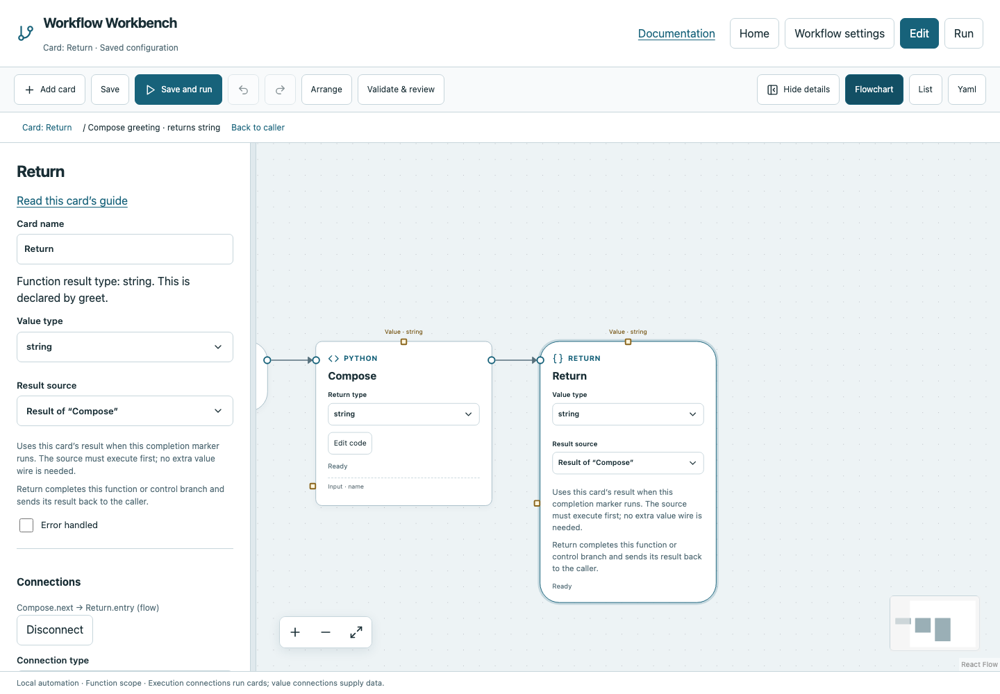

# Return

Complete a function or a controlled branch and pass its result back to the caller or structural card.

## Before you start

Work in **Edit** view in a saved project folder. Start with the downloadable example in its own directory; it includes the surrounding wiring needed for this card. See [connections and values](../values.md) if ports or result sources are unfamiliar.

## Behavior and ports

Return has an execution Entry and no next output. Unlike Finish, it does not end the entire main workflow. In a function it returns to Call function, If/Else, While or Poll until. In a Parallel or Try region it completes that owned region.

A function declares its return type. Configure Return's **Value type** and **Result source** to match it. A condition function must return Boolean True/False, not a printed word, string or number. Each successful path through a function requires a compatible Return.

**Error handled** is an advanced Boolean. Enable it on the Catch region's completion Return only when you have recovered from the original failure. It is not a way to suppress arbitrary errors elsewhere.

**Execution outputs:** None (terminal marker). **Catalog value contract:** `json`; configuration, declared variables/functions and runtime validation refine the actual type as described above. Inspect the typed return value after running.

## Fields and defaults

| UI field | YAML key | Default | Rules and visibility |
|---|---|---|---|
| Value type | `returns` | `"json"` | Primary setting |
| Return value | `value` | `null` | Primary setting |
| Error handled | `handled` | `false` | Advanced |

This operation supports resource locks, interactive/exclusive scheduling and a configured timeout. Automatic retry is not supported for this card; do not attach an operation retry policy. See [common execution settings](../settings.md) for field-by-field configuration, cancellation and evidence.

## Configure it in the browser

1. Open the example, choose **Edit → Workflow settings**, and open **Compose greeting**.
2. Keep **Start → Compose → Return** connected with execution wires.
3. Select Return and choose **Result of “Compose”** as the source. The value is a string.
4. Use **Back to caller** to return to the main graph. The Call function card receives `Hello Reader`.
5. In a Parallel/Catch example, select the Return in the correct region; preserve its ownership when changing its result.

## Configured example



*Actual Workbench screenshot from a disposable documentation project. Select the image to enlarge it in the documentation site.*

[Download the complete runnable workflow](../../examples/return.yaml). Place it in a dedicated folder, add any companion files described above, then use **Home → Add project or file** to open it. It is configured for the current schema; it is not a screenshot-only mockup.

This is the selected card's YAML configuration. The download also includes its Start, completion markers, graph declarations and execution connections:

```yaml
id: return
kind: return
name: Return
config:
  returns: string
  value:
    $ref: card:compose
```

Bindings such as `$ref` in this YAML are represented by named value choices in the browser. They supply values and never start execution. Save your own edits, validate, and compare **Run** evidence with the behavior described above.

## Common mistakes and recovery

Return without a function or owned region is invalid in main. A disconnected Return cannot complete a function. A producer in another function invocation or unchosen branch is unavailable. Returning a value does not create or update a global variable.

If validation reports an issue, click that issue to locate the card on its flowchart. Correct its fields, scope or connections, then Validate again. Check the selected execution's log, attempts and typed result for runtime errors before deliberately rerunning side effects.

## Next example

Try a Boolean Return with If/Else, or publish separate branch strings and inspect Join.

Continue with [the control-flow tutorials](../tutorials/completion.md), [running and evidence](../running.md), or the [card catalog](index.md).
