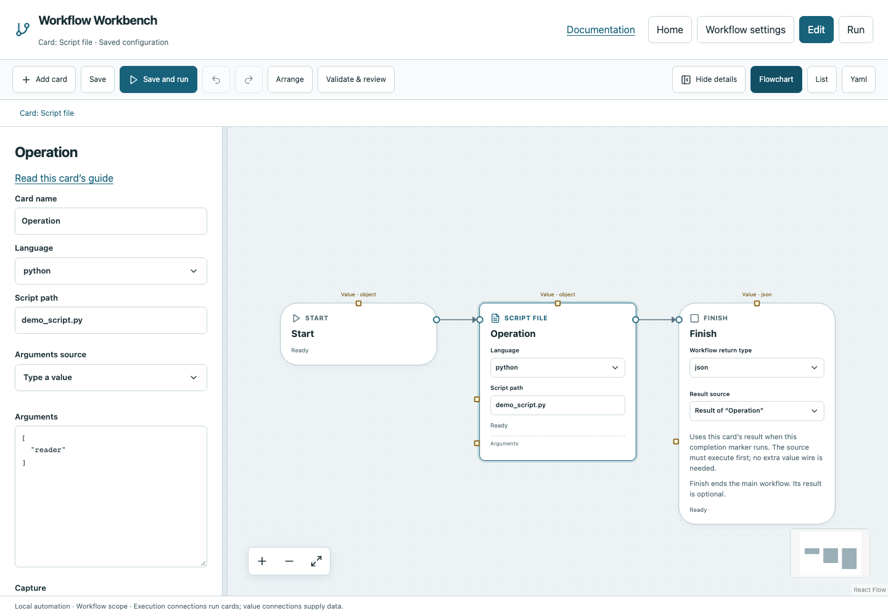

# Script file

Run a Python or Bash file that lives in your project, with explicit arguments.

## Before you start

Work in **Edit** view in a saved project folder. Start with the downloadable example in its own directory; it includes the surrounding wiring needed for this card. See [connections and values](../values.md) if ports or result sources are unfamiliar.

## Behavior and ports

Choose **Language** `python` or `bash`, set **Script path**, and optionally enter **Arguments** as an array of strings. The resolved script path must remain inside the workflow directory. Bash requires an installed Bash executable. Python scripts use the Workbench Python interpreter.

This is a normal script file: print its output and exit normally; a bare top-level `return` is invalid Python. The result/capture contract is the same as Program/Bash: exit_code, stdout, stderr, plus `json` in JSON mode. Named inputs arrive on stdin as `{"inputs":{...}}`; command-line Arguments arrive separately.

**Execution outputs:** `next`. **Catalog value contract:** `object`; configuration, declared variables/functions and runtime validation refine the actual type as described above. Inspect the typed return value after running.

## Fields and defaults

| UI field | YAML key | Default | Rules and visibility |
|---|---|---|---|
| Language | `language` | `"python"` | Options: `python`, `bash` |
| Script path | `path` | `""` | Required |
| Arguments | `arguments` | `[]` | Advanced; Array items must be strings |
| Capture | `capture` | `"text"` | Advanced; Options: `text`, `json` |

This operation supports resource locks, interactive/exclusive scheduling and a configured timeout. Retry is supported but off by default. Use it only when repeating the operation is safe. See [common execution settings](../settings.md) for field-by-field configuration, cancellation and evidence.

## Configure it in the browser

1. Download both the example YAML and [demo_script.py](../../examples/demo_script.py) into the same project folder.
2. Add Script file, choose `python`, and set Script path `demo_script.py`.
3. In advanced Arguments enter `["reader"]`; choose Capture `json`.
4. Connect Start → Script file → Finish. Select the Script file result.
5. Run. The script prints JSON containing name `reader` and its received inputs.

## Configured example



*Actual Workbench screenshot from a disposable documentation project. Select the image to enlarge it in the documentation site.*

[Download the complete runnable workflow](../../examples/script.yaml). Place it in a dedicated folder, add any companion files described above, then use **Home → Add project or file** to open it. It is configured for the current schema; it is not a screenshot-only mockup.

This is the selected card's YAML configuration. The download also includes its Start, completion markers, graph declarations and execution connections:

```yaml
id: operation
kind: script
name: Operation
config:
  language: python
  path: demo_script.py
  arguments:
    - reader
  capture: json
```

Bindings such as `$ref` in this YAML are represented by named value choices in the browser. They supply values and never start execution. Save your own edits, validate, and compare **Run** evidence with the behavior described above.

## Common mistakes and recovery

Copying only the YAML leaves the script missing. Avoid an absolute script path outside the project. Command-line values must be strings, not numbers or a single shell command line. Use a Program card with an explicit interpreter path when the script needs a different Python environment.

If validation reports an issue, click that issue to locate the card on its flowchart. Correct its fields, scope or connections, then Validate again. Check the selected execution's log, attempts and typed result for runtime errors before deliberately rerunning side effects.

## Next example

Place reusable automation in a versioned project script and keep the workflow focused on orchestration.

Continue with [the control-flow tutorials](../tutorials/completion.md), [running and evidence](../running.md), or the [card catalog](index.md).
