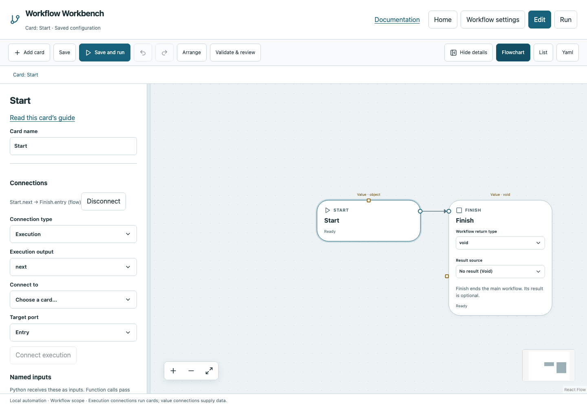

# Start

Choose the first card that executes in a workflow or function. Start is supplied automatically; it is not a command and does not start the server.

## Before you start

Work in **Edit** view in a saved project folder. Start with the downloadable example in its own directory; it includes the surrounding wiring needed for this card. See [connections and values](../values.md) if ports or result sources are unfamiliar.

## Behavior and ports

Keep exactly one Start in each graph. Main Start begins a workflow run; a function Start begins that invocation. Its result is an object containing the graph's resolved named inputs. A function's inputs are separate from the main workflow's inputs.

Start has no incoming execution connection. Connect its round `next` output to your first operation, or directly to Finish in an empty main workflow. You cannot delete Start through the editor. It has no configurable operation fields.

**Execution outputs:** `next`. **Catalog value contract:** `object`; configuration, declared variables/functions and runtime validation refine the actual type as described above. Inspect the typed return value after running.

## Fields and defaults

| UI field | YAML key | Default | Rules and visibility |
|---|---|---|---|
| No operation fields | — | — | Configure its name/connections; see behavior above. |

This operation supports resource locks, interactive/exclusive scheduling and a configured timeout. Automatic retry is not supported for this card; do not attach an operation retry policy. See [common execution settings](../settings.md) for field-by-field configuration, cancellation and evidence.

## Configure it in the browser

1. Run `workbench create`, or choose **New workflow → Blank flowchart** on Home.
2. Open **Edit**. Find Start on the canvas, or select it in **List**.
3. Connect Start's round output to the next card's Entry. For a blank project, leave Start connected to Finish.
4. Declare any **Workflow inputs** in **Workflow settings**. Use value pickers to pass individual inputs to later cards.
5. **Save**, then **Run all**. Start passes immediately; it does not ask for input itself.

## Configured example



*Actual Workbench screenshot from a disposable documentation project. Select the image to enlarge it in the documentation site.*

[Download the complete runnable workflow](../../examples/start.yaml). Place it in a dedicated folder, add any companion files described above, then use **Home → Add project or file** to open it. It is configured for the current schema; it is not a screenshot-only mockup.

This is the selected card's YAML configuration. The download also includes its Start, completion markers, graph declarations and execution connections:

```yaml
id: start
kind: start
name: Start
config: {}
```

Bindings such as `$ref` in this YAML are represented by named value choices in the browser. They supply values and never start execution. Save your own edits, validate, and compare **Run** evidence with the behavior described above.

## Common mistakes and recovery

A missing or duplicate Start makes a graph invalid. A value connection from Start supplies the inputs object; it does not execute the destination. Required inputs without defaults must be supplied by the caller or terminal `--input`.

If validation reports an issue, click that issue to locate the card on its flowchart. Correct its fields, scope or connections, then Validate again. Check the selected execution's log, attempts and typed result for runtime errors before deliberately rerunning side effects.

## Next example

Use a named workflow input to make the greeting example reusable, then pass that input into Python.

Continue with [the control-flow tutorials](../tutorials/completion.md), [running and evidence](../running.md), or the [card catalog](index.md).
