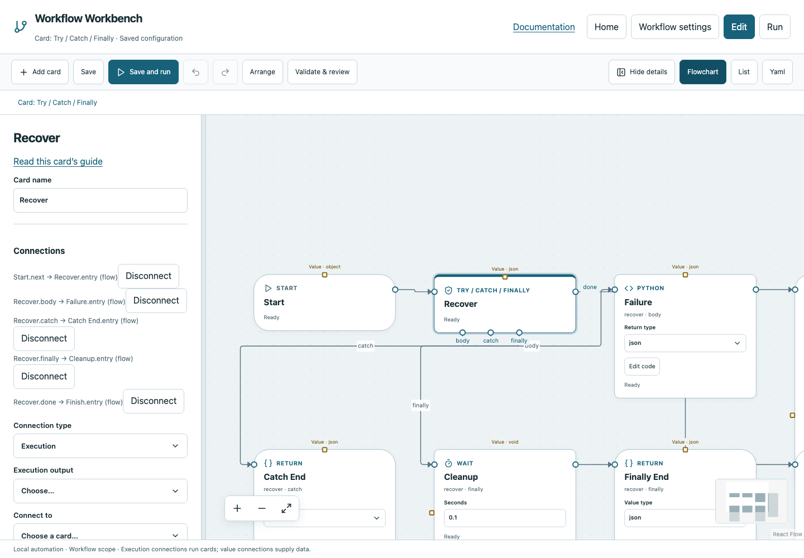

# Try / Catch / Finally

Run work with an explicit recovery path and optional cleanup.

## Before you start

Work in **Edit** view in a saved project folder. Start with the downloadable example in its own directory; it includes the surrounding wiring needed for this card. See [connections and values](../values.md) if ports or result sources are unfamiliar.

## Behavior and ports

Try has Entry, Body, Catch, Finally and Done. Body is the normal work. Catch receives `error.message` and `error.type` after an execution failure. Finally runs after success, handled/unhandled failure and legal Break/Continue. Each connected region ends with an owned Return or permitted loop-control exit.

Recovery is explicit: enable **Error handled** on Catch's completion Return. If not acknowledged, the original failure propagates. Failed attempts remain in reports even if the overall group recovers. A cleanup failure fails the group. Stop cancels execution and does not launch new user cleanup commands; external side effects are not undone automatically.

**Execution outputs:** `body`, `catch`, `finally`, `done`. **Catalog value contract:** `json`; configuration, declared variables/functions and runtime validation refine the actual type as described above. Inspect the typed return value after running.

## Fields and defaults

| UI field | YAML key | Default | Rules and visibility |
|---|---|---|---|
| No operation fields | — | — | Configure its name/connections; see behavior above. |

This structural card coordinates child work. Configure resources/interactive/exclusive scheduling on its executable operations, not on the container. Automatic retry is not supported for this card; do not attach an operation retry policy. See [common execution settings](../settings.md) for field-by-field configuration, cancellation and evidence.

## Configure it in the browser

1. Add Try and connect Start to its Entry and Done to Finish.
2. Connect Body to Python containing `raise ValueError("Demonstration failure")`, then an owned Return.
3. Connect Catch to a Return with value `Recovered` and advanced **Error handled** enabled.
4. Connect Finally to Wait `0.1`, then an owned Return.
5. Save and run. Inspect the failed Python attempt, successful recovery and cleanup sequence.
6. Turn Error handled off and run again to see the unhandled failure.

## Configured example



*Actual Workbench screenshot from a disposable documentation project. Select the image to enlarge it in the documentation site.*

[Download the complete runnable workflow](../../examples/try.yaml). Place it in a dedicated folder, add any companion files described above, then use **Home → Add project or file** to open it. It is configured for the current schema; it is not a screenshot-only mockup.

This is the selected card's YAML configuration. The download also includes its Start, completion markers, graph declarations and execution connections:

```yaml
id: recover
kind: try
name: Recover
config: {}
```

Bindings such as `$ref` in this YAML are represented by named value choices in the browser. They supply values and never start execution. Save your own edits, validate, and compare **Run** evidence with the behavior described above.

## Common mistakes and recovery

Finishing Catch successfully without Error handled is not recovery. Return markers must belong to the correct region. Use retries on eligible operations for transient failures; Try is for explicit recovery logic. Do not rely on Finally for guaranteed cleanup after Stop.

If validation reports an issue, click that issue to locate the card on its flowchart. Correct its fields, scope or connections, then Validate again. Check the selected execution's log, attempts and typed result for runtime errors before deliberately rerunning side effects.

## Next example

Add an error-aware Python card to Catch with named input bound to `error.message`, then return a useful recovery value.

Continue with [the control-flow tutorials](../tutorials/completion.md), [running and evidence](../running.md), or the [card catalog](index.md).
