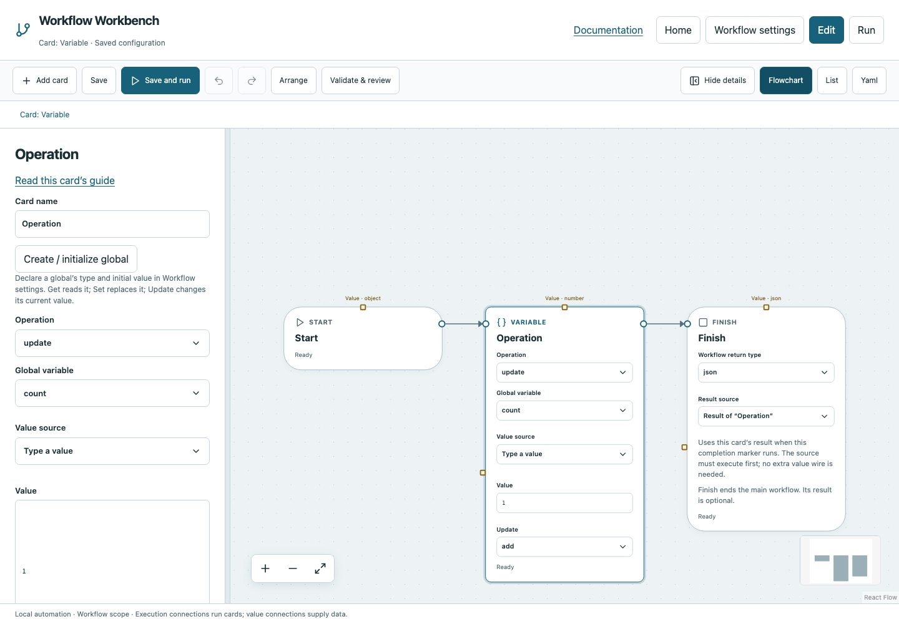

# Variable

Read or change a declared, typed global shared within the current run.

## Before you start

Work in **Edit** view in a saved project folder. Start with the downloadable example in its own directory; it includes the surrounding wiring needed for this card. See [connections and values](../values.md) if ports or result sources are unfamiliar.

## Behavior and ports

Create the variable first in **Workflow settings → Global variables**: enter a name, Add global variable, choose a type and set an initial value. The card's **Create / initialize global** shortcut opens that form. Get/Set/Update do not declare a variable.

`get` returns a copy of its current value; `set` replaces it with **Value**; `update` applies **Update** (`add`, `subtract`, `multiply` or array `append`) using Value. The result is the updated value for Set/Update. All writes must match the declared global type.

Globals reset to initial values at every new Run all. Called functions share them within that run; external workspace workflows initialize separate globals. Parallel read/read is safe, but read/write and write/write conflicts are rejected, including access through functions.

**Execution outputs:** `next`. **Catalog value contract:** `json`; configuration, declared variables/functions and runtime validation refine the actual type as described above. Inspect the typed return value after running.

## Fields and defaults

| UI field | YAML key | Default | Rules and visibility |
|---|---|---|---|
| Operation | `operation` | `"get"` | Options: `get`, `set`, `update` |
| Global variable | `name` | `""` | Required |
| Value | `value` | `0` | Hidden when operation = `get` |
| Update | `operator` | `"add"` | Options: `add`, `subtract`, `multiply`, `append`; Shown when operation = `update` |

This operation supports resource locks, interactive/exclusive scheduling and a configured timeout. Automatic retry is not supported for this card; do not attach an operation retry policy. See [common execution settings](../settings.md) for field-by-field configuration, cancellation and evidence.

## Configure it in the browser

1. In Workflow settings declare `count`, type `number`, initial value `0`.
2. Add Variable and select `count` in **Global variable**.
3. Choose `update`, **Update** `add`, **Value** `1`. The Value field's source picker can also use earlier card results.
4. Connect Start → Variable → Finish and choose Variable as Finish's result source.
5. Save and run. The result is number `1`. Run again: it is `1` again because globals reset.
6. Add a Get card after the update when another operation needs the current count.

## Configured example



*Actual Workbench screenshot from a disposable documentation project. Select the image to enlarge it in the documentation site.*

[Download the complete runnable workflow](../../examples/variable.yaml). Place it in a dedicated folder, add any companion files described above, then use **Home → Add project or file** to open it. It is configured for the current schema; it is not a screenshot-only mockup.

This is the selected card's YAML configuration. The download also includes its Start, completion markers, graph declarations and execution connections:

```yaml
id: operation
kind: variable
name: Operation
config:
  operation: update
  name: count
  operator: add
  value: 1
```

Bindings such as `$ref` in this YAML are represented by named value choices in the browser. They supply values and never start execution. Save your own edits, validate, and compare **Run** evidence with the behavior described above.

## Common mistakes and recovery

Unknown names must be declared, not typed as raw global references. Setting a numeric global to `"1"` fails; enter number `1`. For concurrent work, return independent branch values through Join instead of updating the same global.

If validation reports an issue, click that issue to locate the card on its flowchart. Correct its fields, scope or connections, then Validate again. Check the selected execution's log, attempts and typed result for runtime errors before deliberately rerunning side effects.

## Next example

Use Get count plus Calculate in a While condition, or maintain an array with Update append.

Continue with [the control-flow tutorials](../tutorials/completion.md), [running and evidence](../running.md), or the [card catalog](index.md).
