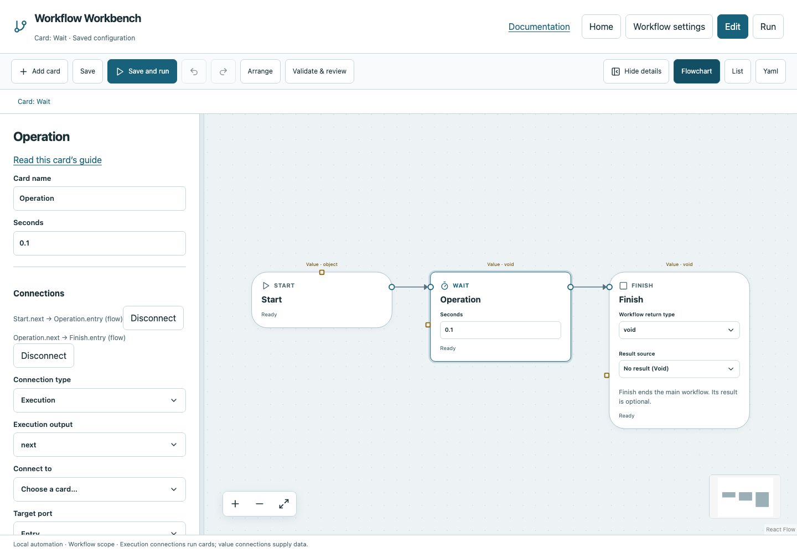

# Wait

Pause a workflow path for a configured number of seconds without blocking cancellation.

## Before you start

Work in **Edit** view in a saved project folder. Start with the downloadable example in its own directory; it includes the surrounding wiring needed for this card. See [connections and values](../values.md) if ports or result sources are unfamiliar.

## Behavior and ports

**Seconds** is a nonnegative finite number; fractional delays such as `0.1` are allowed. Zero completes immediately. Wait returns Void, so its completion is represented by status rather than a value to compare.

Wait delays one path; it does not poll an external condition. User Stop cancels the waiting card. Pause scheduling prevents new work but is different from Stop or a configured delay.

**Execution outputs:** `next`. **Catalog value contract:** `void`; configuration, declared variables/functions and runtime validation refine the actual type as described above. Inspect the typed return value after running.

## Fields and defaults

| UI field | YAML key | Default | Rules and visibility |
|---|---|---|---|
| Seconds | `seconds` | `1` | Primary setting |

This operation supports resource locks, interactive/exclusive scheduling and a configured timeout. Automatic retry is not supported for this card; do not attach an operation retry policy. See [common execution settings](../settings.md) for field-by-field configuration, cancellation and evidence.

## Configure it in the browser

1. Add Wait between Start and Finish.
2. Set Seconds to `0.1`, or `2` if you want to observe its running state.
3. Leave Finish at No result (Void), because Wait has no value payload.
4. Save and run. Inspect elapsed time and completion.
5. Try Stop during a longer Wait to observe cancelled status.

## Configured example



*Actual Workbench screenshot from a disposable documentation project. Select the image to enlarge it in the documentation site.*

[Download the complete runnable workflow](../../examples/wait.yaml). Place it in a dedicated folder, add any companion files described above, then use **Home → Add project or file** to open it. It is configured for the current schema; it is not a screenshot-only mockup.

This is the selected card's YAML configuration. The download also includes its Start, completion markers, graph declarations and execution connections:

```yaml
id: operation
kind: wait
name: Operation
config:
  seconds: 0.1
```

Bindings such as `$ref` in this YAML are represented by named value choices in the browser. They supply values and never start execution. Save your own edits, validate, and compare **Run** evidence with the behavior described above.

## Common mistakes and recovery

Negative durations and strings are invalid. Do not assume a delay proves a service/file is ready; use Poll until for that. A Void output cannot feed a comparison.

If validation reports an issue, click that issue to locate the card on its flowchart. Correct its fields, scope or connections, then Validate again. Check the selected execution's log, attempts and typed result for runtime errors before deliberately rerunning side effects.

## Next example

Put a short Wait between deliberate user-facing actions, or use polling for condition-based readiness.

Continue with [the control-flow tutorials](../tutorials/completion.md), [running and evidence](../running.md), or the [card catalog](index.md).
