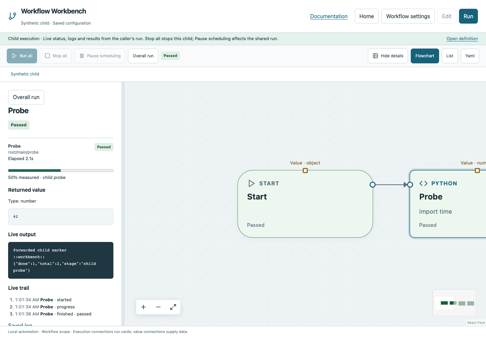
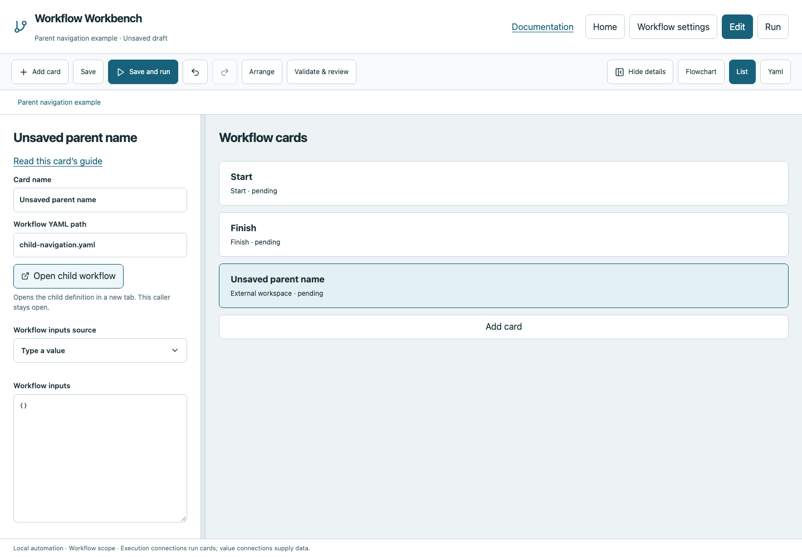
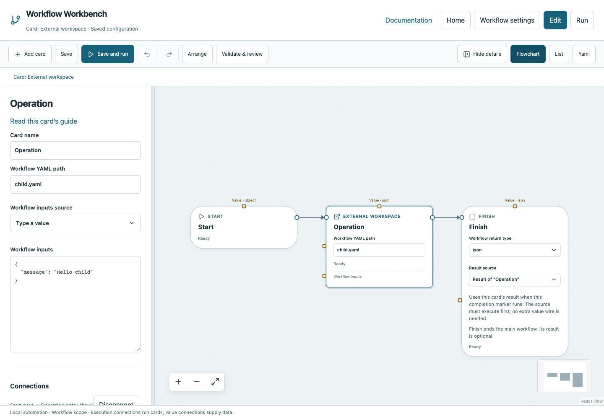

# External workspace

Run a workflow YAML from another workspace and consume its Finish result.

## Before you start

Work in **Edit** view in a saved project folder. Start with the downloadable example in its own directory; it includes the surrounding wiring needed for this card. See [connections and values](../values.md) if ports or result sources are unfamiliar.

## Behavior and ports

**Workflow YAML path** selects the child; a relative path resolves from the parent's resolved execution workspace. **Workflow inputs** supplies explicit arguments. Download required child files alongside an example. The child resolves its own optional `workspace` relative to its YAML directory (default `.`) and initializes its own declared globals. Supply child inputs explicitly; the parent's Run inputs dialog and discovery button do not automatically collect child inputs.

Unlike a function, this is a separate workflow with main Start/Finish. It shares the parent run's cancellation and concurrency budget. Recursion through workspaces is rejected. Child evidence is nested beneath the parent; manual prompts surface in the parent browser. Select the card to inspect forwarded live logs, child status, active operations, **Child stage** progress and **Open child workflow report**. See [nested workflow inspection](../settings.md#inspect-nested-workflows). The child's Finish result becomes the card's typed value.

**Execution outputs:** `next`. **Catalog value contract:** `json`; configuration, declared variables/functions and runtime validation refine the actual type as described above. Inspect the typed return value after running.

## Open the child workflow

In **Edit**, use **Open child workflow** below Workflow YAML path, on the card or in its inspector. In **Run**, the same action is on the canvas card and in its selected-card inspector, including before execution. In Edit it opens the saved definition. In Run, after the caller has started its child, it opens that exact child execution in a new tab. Before execution it opens the definition in Run mode. Opening either page never starts another run. The caller's draft and running work stay open.

The path resolves from the parent's declared execution workspace, not the YAML's containing folder when those differ. Unsaved edits to the path are respected without saving the parent. After a dynamic call executes, Run navigation can use the actual resolved child source. Before that, an unresolved dynamic path produces an explanatory error. Missing/invalid child files show an error beside the action. If the browser blocks a new tab, use the resolved link offered below the button.

The live child tab shows running cards, live logs, return values and manual prompts from the caller's actual execution. You can record a waiting decision there or in the parent. Reloading retains the selected invocation; two parallel calls to the same file have separate execution URLs. **Run all** and editing are disabled in this inspection view, including after completion. After the parent and other work have stopped, select a card and choose **Run from here** to start at that card and follow its flow to Finish or Return. It uses the executed configuration snapshot, reuses compatible successful upstream results and variable changes when available, receives a new run URL and preserves the original evidence. It does not resume the parent. Use **Open definition** for a separate editable tab. Opening a definition does not turn it into a separate running job.

**Stop all** in the child tab cancels that child and its descendants. The parent receives its cancelled/failure result according to its configured recovery behavior. **Pause scheduling** affects the shared coordinator, including sibling work. Completed child results, logs and HTML reports remain accessible while the server session retains the run, even after a new parent run starts. After restarting the server, old live execution URLs show an unavailable-execution message; use saved HTML reports for historical evidence.





## Fields and defaults

| UI field | YAML key | Default | Rules and visibility |
|---|---|---|---|
| Workflow YAML path | `path` | `""` | Required |
| Workflow inputs | `inputs` | `{}` | Advanced |

This structural card coordinates child work. Configure resources/interactive/exclusive scheduling on its executable operations, not on the container. Automatic retry is not supported for this card; do not attach an operation retry policy. See [common execution settings](../settings.md) for field-by-field configuration, cancellation and evidence.

## Configure it in the browser

1. Download both [workspace.yaml](../../examples/workspace.yaml) and [child.yaml](../../examples/child.yaml) into a project.
2. Select External workspace and set Workflow YAML path `child.yaml`.
3. In Workflow inputs provide `{"message":"Hello child"}`.
4. Connect Start → External workspace → Finish and select the child result.
5. Save and run. Inspect the child execution and returned greeting object.

## Configured example



*Actual Workbench screenshot from a disposable documentation project. Select the image to enlarge it in the documentation site.*

[Download the complete runnable workflow](../../examples/workspace.yaml). Place it in a dedicated folder, add any companion files described above, then use **Home → Add project or file** to open it. It is configured for the current schema; it is not a screenshot-only mockup.

This is the selected card's YAML configuration. The download also includes its Start, completion markers, graph declarations and execution connections:

```yaml
id: operation
kind: workspace
name: Operation
config:
  path: child.yaml
  inputs:
    message: Hello child
```

Bindings such as `$ref` in this YAML are represented by named value choices in the browser. They supply values and never start execution. Save your own edits, validate, and compare **Run** evidence with the behavior described above.

## Common mistakes and recovery

A path to an old unsupported YAML schema is rejected without conversion. Missing child files/inputs fail the call. Layout areas do not create a workspace. Child global changes do not overwrite parent globals. Stop propagates to the child but cannot undo external side effects.

If validation reports an issue, click that issue to locate the card on its flowchart. Correct its fields, scope or connections, then Validate again. Check the selected execution's log, attempts and typed result for runtime errors before deliberately rerunning side effects.

## Next example

Compose reusable build/test workflows across project folders, with explicit inputs and typed Finish results.

Continue with [the control-flow tutorials](../tutorials/completion.md), [running and evidence](../running.md), or the [card catalog](index.md).
