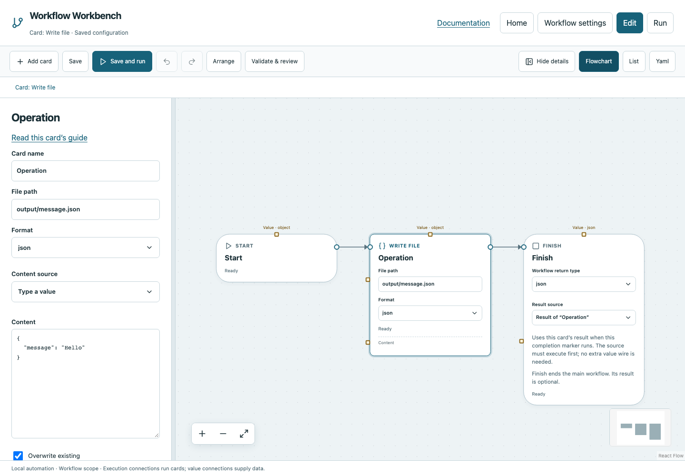

# Write file

Write text or JSON within the project, with explicit overwrite control.

## Before you start

Work in **Edit** view in a saved project folder. Start with the downloadable example in its own directory; it includes the surrounding wiring needed for this card. See [connections and values](../values.md) if ports or result sources are unfamiliar.

## Behavior and ports

Set **File path** and **Format**, then advanced **Content** and **Overwrite existing**. Text format requires a string; JSON accepts JSON-compatible values and serializes them with indentation. Missing parent directories are created. The returned object contains relative `path` and UTF-8 byte count.

Overwrite is False by default: an existing file fails safely. Enable it deliberately when reruns should replace generated output; that replacement is atomic. File content is bounded at 1 MiB. Writes cannot escape the project through `..` or a symlink.

**Execution outputs:** `next`. **Catalog value contract:** `object`; configuration, declared variables/functions and runtime validation refine the actual type as described above. Inspect the typed return value after running.

## Fields and defaults

| UI field | YAML key | Default | Rules and visibility |
|---|---|---|---|
| File path | `path` | `""` | Required |
| Format | `format` | `"text"` | Options: `text`, `json` |
| Content | `value` | `""` | Advanced |
| Overwrite existing | `overwrite` | `false` | Advanced |

This operation supports resource locks, interactive/exclusive scheduling and a configured timeout. Retry is supported but off by default. Use it only when repeating the operation is safe. See [common execution settings](../settings.md) for field-by-field configuration, cancellation and evidence.

## Configure it in the browser

1. Add Write file; choose path `output/message.json` and Format `json`.
2. In advanced Content enter `{"message":"Hello"}` or select a prior card's returned object.
3. For repeatable generated output, enable Overwrite existing.
4. Connect Start → Write file → Finish and save.
5. Run and inspect the generated project file plus the returned path/bytes evidence.

## Configured example



*Actual Workbench screenshot from a disposable documentation project. Select the image to enlarge it in the documentation site.*

[Download the complete runnable workflow](../../examples/write_file.yaml). Place it in a dedicated folder, add any companion files described above, then use **Home → Add project or file** to open it. It is configured for the current schema; it is not a screenshot-only mockup.

This is the selected card's YAML configuration. The download also includes its Start, completion markers, graph declarations and execution connections:

```yaml
id: operation
kind: write_file
name: Operation
config:
  path: output/message.json
  format: json
  value:
    message: Hello
  overwrite: true
```

Bindings such as `$ref` in this YAML are represented by named value choices in the browser. They supply values and never start execution. Save your own edits, validate, and compare **Run** evidence with the behavior described above.

## Common mistakes and recovery

An existing destination with overwrite disabled is an error, not a skipped write. Text mode cannot directly store an object: select JSON. The workflow runs with your local permissions; Stop does not undo a completed write.

If validation reports an issue, click that issue to locate the card on its flowchart. Correct its fields, scope or connections, then Validate again. Check the selected execution's log, attempts and typed result for runtime errors before deliberately rerunning side effects.

## Next example

Capture HTTP response.json, save it, then read it back in a later workflow.

Continue with [the control-flow tutorials](../tutorials/completion.md), [running and evidence](../running.md), or the [card catalog](index.md).
