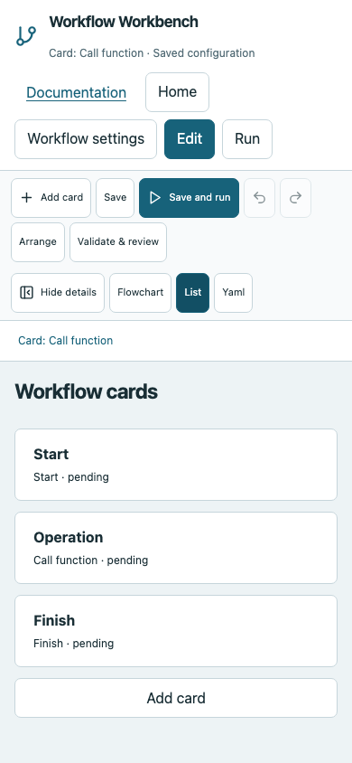
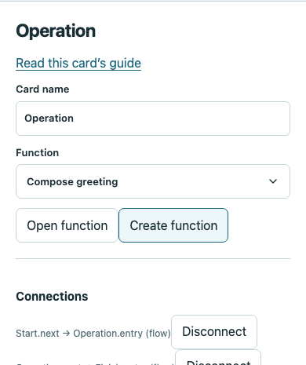
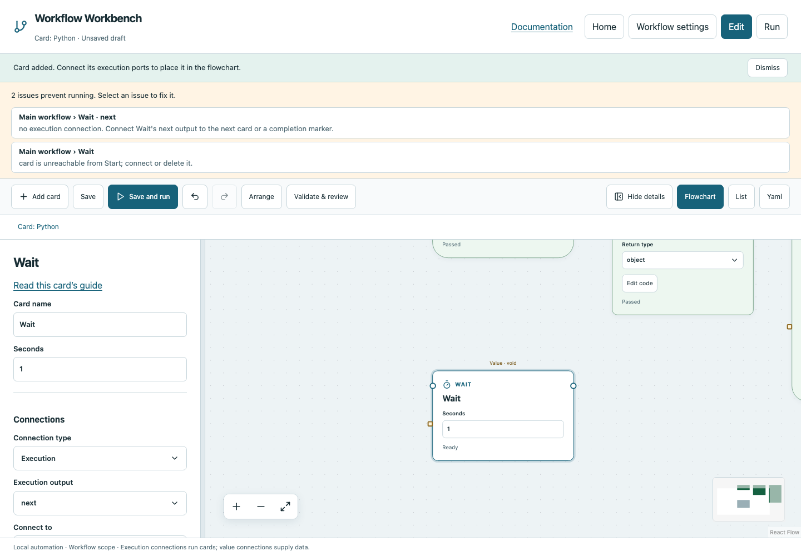

# Edit flowcharts

Opening a workflow begins in Run view. Choose **Edit** to change cards. Edits remain a browser draft until Save. During active execution, editing is disabled to keep the saved workflow consistent with its evidence.

## Three views, one workflow

- **Flowchart:** drag cards and connect ports. Layout positions never determine execution order.
- **List:** select cards and configure their dependencies/values through controls. This is useful on small screens and with a keyboard.
- **YAML:** edit the same workflow contract directly. Invalid YAML/JSON must be corrected; the app does not silently keep a previous value when a new field is malformed.

Switching away from YAML validates document structure, not full run readiness. Missing connections can remain a saved draft. Function graphs have their own views; the breadcrumb returns to the caller.

*The List and selected settings are separate reading/interaction areas. Scroll to reach the details on a narrow screen.*

## Add, configure and wire cards

**Add card** or right-click empty canvas space opens the categorized picker. A new card is selected and brought into view. Primary fields are editable on the card; code, named inputs, advanced options and connection controls are in the left details panel. Advanced card fields are fields omitted from the compact card; they do not all have separate disclosure toggles. **Advanced execution settings** is an expandable JSON settings field.

Click a card to select it. Edit **Card name** to make logs and validation messages meaningful. Right-click a card for available actions, including Duplicate card and Delete card. Right-click an edge to delete that connection. Start is required and cannot be deleted. Deleting a structural card can remove its owned descendants and paired Join; inspect the result before saving or undo it immediately.

Round execution outputs normally connect to exactly one next card. An If has one destination per True/False port; Parallel is the explicit fan-out. Square value wires bind a field or named input. See [connections and values](values.md) before wiring data.

**Undo/Redo** applies to editor changes; it does not undo external work already performed by a run. **Arrange** lays out cards. Zoom controls change the viewport, not execution. Dragging/selecting during a run changes inspection and follow-active behavior, not scheduling.

## Layout and panel controls

Dotted/collapsible areas and annotations organize the drawing. Area membership is different from execution ownership. A collapsed card is not skipped by the engine. See the individual layout pages in the [card reference](cards/index.md).

Drag the details divider to resize the panel, or use **Hide details** / Show details. The panel and List scroll independently. On small screens, use List and document scrolling to reach fields. Custom dropdowns support keyboard selection; normal focus outlines remain visible.

## Save versus validate

**Save** writes a structurally valid draft atomically, even if its execution graph is incomplete. It reports outstanding readiness issues. **Validate & review** checks the execution graph and shows the saved-to-draft diff. Run also enforces readiness but does not automatically approve manual steps.

Validation diagnostics appear after explicit checks, not continuously during every edit. Editing clears stale diagnostics. Click an issue to select/focus the affected card on its flowchart, then fix fields/connections and validate again. Human names identify the graph/card; stable IDs still exist in YAML.

## Conflicts, leaving and recovery

Leaving an unsaved workflow prompts before discarding changes. Opening Documentation uses a separate tab and preserves your editor. External edits cause a revision conflict; reload/reconcile rather than overwriting another change.

Some submitted drafts are backed up on the server against their base revision. A **Draft backed up** message means the submission was captured; after reload the updated editor can restore a revision-matched draft for saving. This is not continuous autosave: browser-only changes never submitted to the server can still be lost. Save deliberately.

See [troubleshooting](troubleshooting.md) for incomplete graphs, malformed values and local request-token errors.
