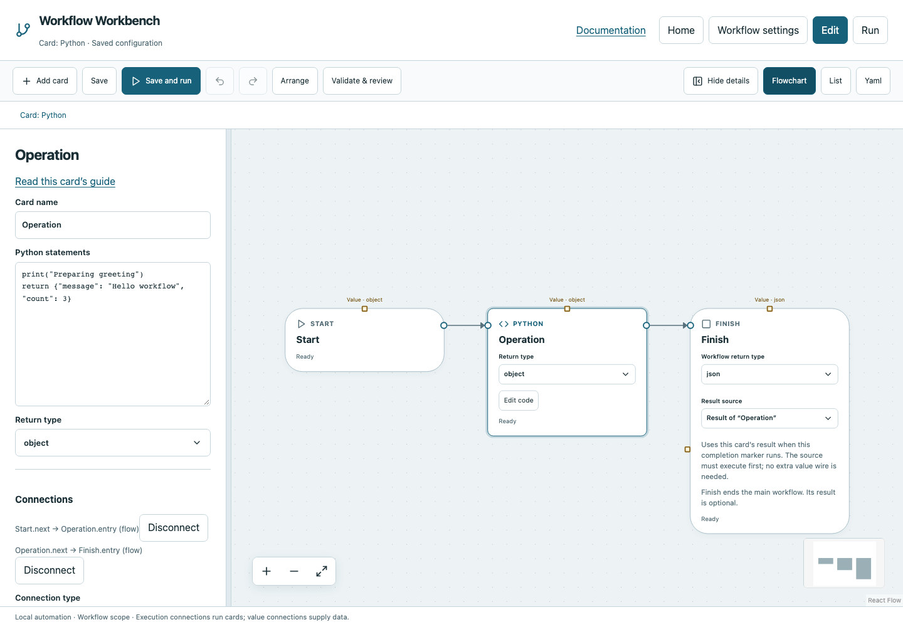
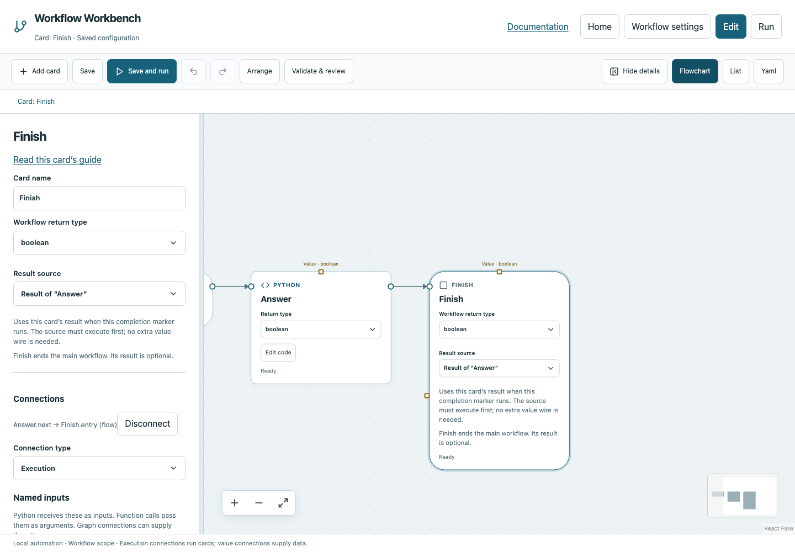
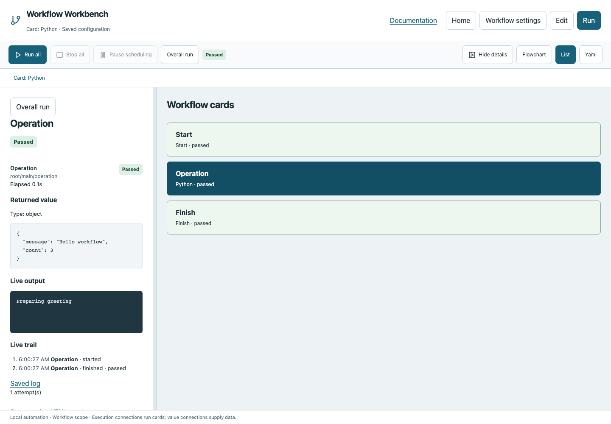

# Your first workflow

This walkthrough creates a greeting, logs a message, and returns a JSON object. You will see the difference between running a card and using its result.

## 1. Open a blank workflow

Run `workbench create` from a new folder, or choose **New workflow** on Home, select your project, use a unique YAML filename and choose **Blank flowchart**. Opening a workflow shows Run view. Choose **Edit** to change it.

Keep Start and Finish. Start currently connects directly to Finish; you will insert Python between them.

## 2. Add and configure Python

Choose **Add card → Python**, or right-click an empty canvas position and choose Python. The new card is selected. In its details panel set **Return type** to `object` and enter these **Python statements**:

```python
print("Preparing greeting")
return {"message": "Hello workflow", "count": 3}
```

Code lives in the details panel; the compact canvas card shows its primary settings. You do not need to define a Python function around the statements. `print` is a log; `return` supplies the result.


## 3. Connect execution

Connect Start's round output to Python's Entry, then Python's round output to Finish's Entry. Connecting Start to Python replaces Start's earlier next connection. Alternatively right-click the old line and delete the connection before adding the two new wires.

In List view select Start, choose the target under **Connections**, then **Connect execution**. Repeat for Python → Finish. Ordinary next outputs have one destination; use Parallel when simultaneous work is intentional.



## 4. Choose the returned value

Select Finish. Under **Result source**, choose **Result of “Python”** (or the card's current name). The round wire says when Finish runs; this setting says what it returns. Do not leave a typed object return with a missing/null result.

You can also keep Finish at **No result (Void)** when only side effects matter. For this walkthrough, publish the object so you can inspect it.



## 5. Save, validate and run

Click **Save** to write your draft. Use **Validate & review** to check readiness and review the diff. Validation issues are shown on request; clicking an issue selects that card on the flowchart. Incomplete graphs can be saved, but cannot run.

Choose **Run**, then **Run all**. If your workflow has declared inputs, review the input dialog and start with its values. A new run resets globals and may repeat external side effects.

## 6. Read the evidence

Select Python in Run view. Its live log contains Preparing greeting. The typed value contains message and count. Finish's result is the same object. The left panel's **Overall run** shows the workflow's status and active work; selecting a card switches to its details.



A log is not a result: changing Python to only print the object would not return it. Change the returned value to `False` and its declared type to Boolean to explore a successful false result.

## Practice with files

Download [the complete Python example](../examples/python.yaml) for this workflow. To also write a file, use [Python return and file output](starters/python.md): it passes Python's object into Write file, producing `output/result.json`. Read the [Python](cards/python.md), [Finish](cards/finish.md) and [Write file](cards/write_file.md) pages for all fields and failures.
