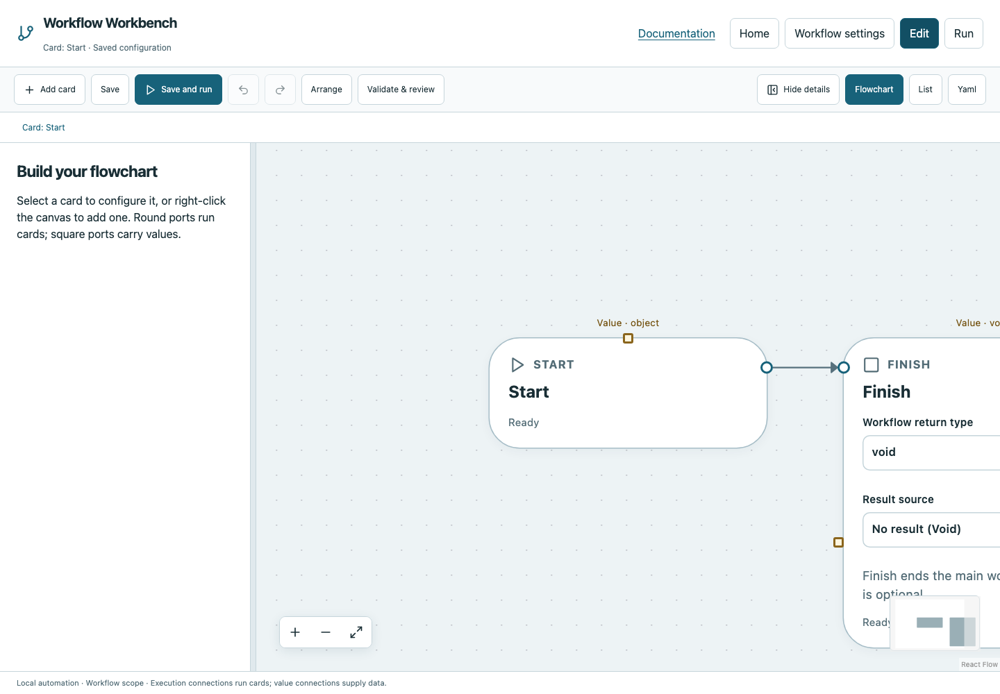

# Install and create a project

## Install the Python package

Use Python 3.11 or newer. Download the actual wheel artifact for the version you intend to install and verify its published SHA-256 when available. The following assumes that wheel is in your current directory; replace its version with your downloaded artifact.

```bash
python3 -m venv .venv-workbench
.venv-workbench/bin/python -m pip install ./release_workbench-0.18.0a5-py3-none-any.whl
.venv-workbench/bin/workbench --version
```

On Windows, use `python` if that is your Python command, and the corresponding `.venv-workbench\Scripts\python.exe` and `.venv-workbench\Scripts\workbench.exe`. Native Windows execution remains unverified. Activate the environment, use its explicit executable path, or install the wheel with a Python tool manager to expose `workbench` on PATH.

## Optional npm/npx launcher

The repository can build a local `codewhen-workbench-0.18.0-preview.5.tgz` archive. **The scoped npm package has not been published as part of this documentation delivery.** Do not expect `npx @codewhen/workbench` to work until an actual publication is confirmed.

With the local archive downloaded into your current directory:

```bash
npm install -g ./codewhen-workbench-0.18.0-preview.5.tgz
workbench --version
```

Or run that archive without a global install:

```bash
npx --package ./codewhen-workbench-0.18.0-preview.5.tgz workbench serve
```

This wrapper needs Node 18+ and Python 3.11+. It verifies its bundled wheel, creates an isolated runtime under `~/.cache/codewhen-workbench/`, and installs Python dependencies on first launch. It does not replace global Python packages. Set `WORKBENCH_PYTHON` to a specific executable if discovery chooses the wrong interpreter. Subsequent launches reuse the runtime; network is required for initial dependency installation, not for reading the bundled manual.

## Create a blank project here

1. Make a dedicated folder for your workflow and scripts.
2. Open a terminal in that folder and run `workbench create`.
3. Enter a project name and YAML filename, or accept `workflow-workbench.yaml`.
4. The wizard creates a blank Start → Finish workflow in the current directory and opens it in the dashboard.
5. Existing files are never overwritten. Choose another filename if the default already exists.

```bash
mkdir workflow-demo
cd workflow-demo
workbench create
# Or skip wizard questions:
workbench create --name "Workflow demo" --config demo.yaml
```



*The project wizard opens the real blank workflow. It does not run any card.*

## Open an existing project

```bash
workbench
workbench serve
workbench run
```

All three open the dashboard for the current directory. `run` without `--non-interactive` does not execute YAML automatically. A matching dashboard on the chosen port is reused and the project is registered there. A different library occupying that port requires another port.

```bash
workbench serve --port 3105
workbench serve --storage ~/Documents/WorkbenchLibrary --no-open
```

Default port is 3104; use the URL printed by your command rather than assuming the development dashboard's port. Default storage is `~/.workbench-preview-v3`. Stop the serving terminal with Ctrl+C; active work is cancelled and the server waits briefly for cleanup. A second CLI invocation that only reuses the server exits without stopping the original server.

Next: [your first workflow](first-workflow.md), [Home and projects](projects.md), or [CLI reference](cli.md).
