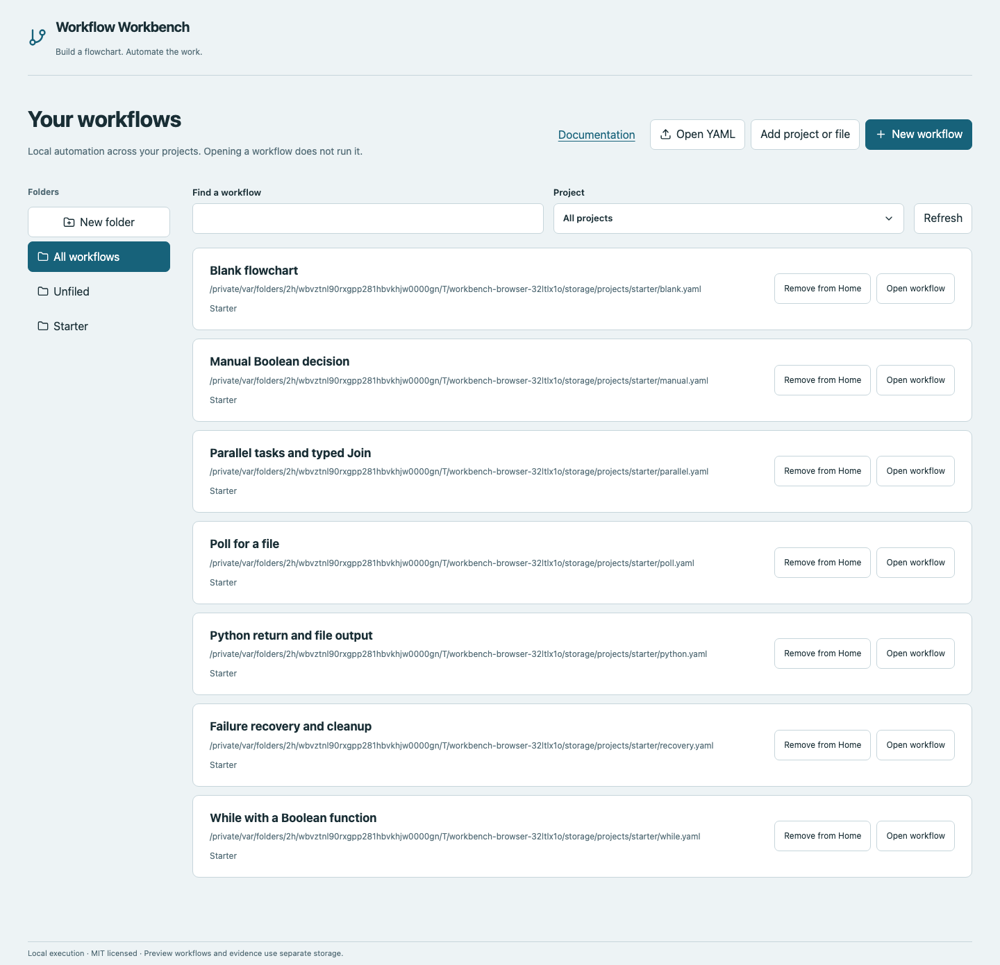
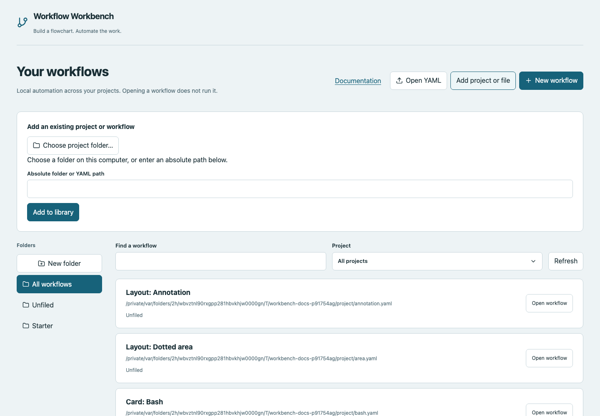

# Home and projects

Home is a directory of workflow entry points across local project folders. A project contains actual YAML/scripts. A Home folder is an organizational label; moving an entry between Home folders normally leaves its file on disk.

## Add a project or existing file

1. Choose **Add project or file**.
2. Choose **Choose project folder…** to open the host's native folder picker. On a local Mac this is the Finder-style folder dialog; Windows uses its folder selection dialog. Linux needs Zenity or KDialog.
3. Review the absolute path, then choose **Add to library**.
4. Or paste an absolute folder/YAML path directly. Cancelling the system picker preserves the existing field value.

The picker opens on the computer running the server, not a remote browser device. It does not upload an entire directory. Registration discovers top-level `.yaml`/`.yml` files; nested workflow folders must be added separately. Missing native UI/headless hosts can use the path field.

## Open YAML versus register a path

**Open YAML** uses the browser's file picker to read a selected YAML's contents. Valid current-schema contents proceed to an import dialog where you choose the project and filename; the app creates a new file there, refusing overwrites. Invalid YAML displays an error. It cannot infer the file's original full filesystem path from a browser upload.

To edit an existing file in place, register its absolute path with **Add project or file** instead. Always bring companion scripts/child YAML files into the chosen project directory when importing a download.

## Create and organize workflows

**New workflow** asks for name, project, YAML filename and Starter template. Blank gives Start → Finish; other templates demonstrate specific capabilities. The file is created only when you submit the form.

Use **New folder** to add a library organization label. Right-click a folder to rename/remove it, or an entry to move it to a library folder. Removing an organization folder unfiles its entries; it does not delete their YAML or project directory. Project filtering uses actual registered directories, independently of Home folders.

Search finds workflow names and paths. **Refresh** reloads registered entries. Register a project again to discover newly added YAML files. Invalid or missing files remain visible with an explanatory error instead of appearing runnable. Correct the file/path before opening it again.

## Remove workflows or projects from Home

Choose **Remove from Home** on a workflow row, or right-click the row and choose the same action. Review the confirmation, then choose **Remove from Home** again. **Cancel** keeps the entry.

To remove an entire project, select it in the **Project** filter, then choose **Remove project from Home**. Confirmation removes its workflow entries, including registered files within nested folders.

These actions only remove library entries. YAML files, project directories, saved drafts and historical run reports remain on disk. Removed entries stay hidden after refresh or restart, including Starter entries. To restore them, use **Add project or file** with the original path; adding a project again discovers its top-level YAML files. Stop active runs before removing their workflow or project.

Workbench does not delete files or directories from disk through these controls. Use your file manager if you also want to delete physical files.

## Starter versus personal workflows

Starter examples live in `<storage>/projects/starter` and appear in Home's **Starter** folder. Startup creates missing examples without overwriting existing edits. Make a copy into your own project when building real automation, with the scripts/resources it needs. Do not rely on clearing Home folders to delete disk files.

The current development setup may preserve edited former examples as personal workflows and provide fresh Starter copies separately. Their names can match; use the displayed file path and project filter to distinguish them.

## History and opening work

Opening an entry does not execute commands. Home can display previous run reports separately from current workflow configuration. Read [running and evidence](running.md) for how fresh runs differ from resume. Before moving project files manually, see [storage and backups](storage.md); library IDs and evidence references need deliberate handling.
