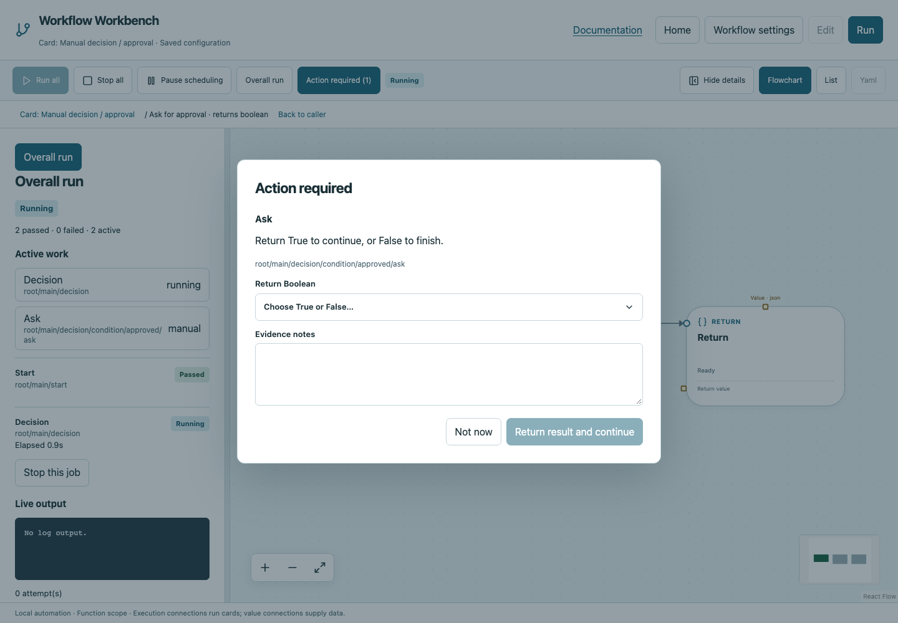

# Run and inspect workflows

## Start a fresh run

Save and validate your workflow, then choose **Run → Run all**. Review the declared workflow inputs in the dialog when present. A fresh run starts at main Start, resets globals to initial values, and can repeat all external side effects. Opening the project or choosing Run view alone does not execute cards.

Execution follows wires, not canvas positions. If selects one path; While may run zero iterations; Parallel is the only explicit concurrent fan-out. Editing is locked during active execution.

## Overall and selected inspection

Overall run shows workflow status, counts, active paths and elapsed/progress information. The canvas/List can follow active work automatically. Selecting a card, dragging the canvas or scrolling away switches to specific-card inspection and disables following. **Overall run** in the left panel returns to the overview and follow-active behavior.

Select a card to see its live logs, event trail, attempts, elapsed time and typed return value. Parent structural/function cards include relevant child evidence; repeated executions have hierarchical paths identifying invocation/iteration. A completed card's details remain inspectable.


| State | Interpretation |
|---|---|
| pending / queued | Not started or awaiting coordinator resources |
| running | Executing or coordinating active children |
| waiting for manual evidence | Operator action is needed in the browser prompt |
| passed / recorded | Successful operation or recorded intervention |
| failed | Command, contract, timeout or workflow error |
| skipped | Unselected branch or body that did not execute |
| cancelled | Explicit Stop, distinct from failure |
| blocked | Required evidence or deliberate resume action is missing |

Labels accompany colors: passed green, failed red, skipped/cancelled grey; running has a green border animation that respects reduced-motion settings.

## Human decisions

Manual cards open an evidence prompt. Enter notes and choose the required Boolean decision or record approval. Each invocation needs a new response, even within a loop. False is valid data; use If to branch on it. If you dismiss the prompt, reopen the waiting intervention from the run controls. Noninteractive runs block instead of assuming approval.



## Stop and pause

**Stop all** cancels active and pending work, propagating to child workflows and processes. A selected job's stop control targets its execution subtree. Already completed side effects remain. Detached processes that escape process groups and observation are outside the cleanup guarantee.

**Pause scheduling** prevents new operations/cards from starting; it does not suspend an already running command. Resume scheduling when ready. Stop is not a request to execute additional Finally cleanup commands; cancellation does not launch new user cleanup work.

## Measured progress versus estimates

A command can emit newline-terminated progress records:

```text
::workbench::{"done":3,"total":10,"stage":"Checking packages"}
```

Use `print` in Python for such log lines, not the return channel. Values must be finite ordered bounds with total greater than zero. Valid records are measured progress. **Expected seconds** is only an estimate; the app labels it and does not claim completion before actual success. Condition-dependent loops and polling show elapsed time/counts instead of invented percentages or ETAs.

## Reports and history

Each run writes summary JSON, event JSONL, per-execution logs and a script-free HTML report under the selected storage directory. Reports retain failed attempts even after recovery. Open them from run evidence or Home history. Child workflows retain nested evidence. Secret masking applies to logs/results/events, but credentials should still never be embedded in workflow YAML.

## Rerun versus resume

Run all is a fresh execution. Terminal resume deliberately reuses matching successful evidence:

```bash
workbench run --non-interactive --config workflow-workbench.yaml --resume RUN_ID
workbench run --non-interactive --config workflow-workbench.yaml --resume RUN_ID --retry-interrupted
```

Supply the same required inputs and storage. Matching successful side effects are not rerun automatically; interrupted/failed work needs the explicit retry option. Changed configuration, declared source files or inputs require a new run. Layout changes do not change execution identity. Redacted saved results cannot safely become computation values; the runner asks for a new run rather than guessing the secret. This is not rollback or a guarantee that external systems remained unchanged.
