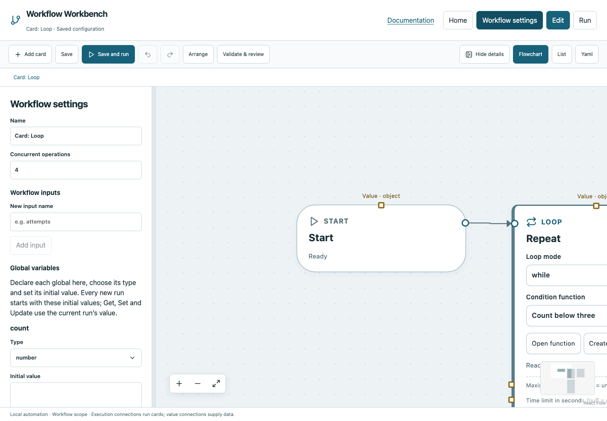

# Settings, resources and secrets

## Workflow settings

Open **Workflow settings** to configure the name, concurrent operation budget, workflow inputs, declared globals, functions, environment and secrets. The YAML reference describes additional source fingerprint patterns. Settings are saved with the workflow; the runtime does not obtain them from a CMS or hosted account.

| YAML field | Meaning and default |
|---|---|
| version | Required schema version `3` |
| name | Human-readable workflow name |
| concurrency | Shared operation budget; default `4`, allowed 1–64 |
| inputs | Named typed inputs; optional default/description |
| globals | Typed run variables with required initial values |
| functions | Named signatures and dedicated graph references |
| graphs | Main/function cards and connections |
| layout | Optional positions/areas; presentation only |
| environment | String environment overrides; default no explicit overrides |
| secrets | Environment names whose values must be masked |
| source_paths | Relative source globs included in resume fingerprints |

Declare globals before Get/Set/Update. A global cannot be Void. Function inputs/intermediate results are isolated, but functions share the current run's globals. The [variables](tutorials/variables.md) and [functions](tutorials/functions.md) tutorials show the exact UI sequence.



## Per-card execution settings

Select an executable card and expand **Advanced execution settings**. The field **Timeout, locks, retries and environment** is a JSON object, not separate named switches. For example, enter `{"timeout":60,"resources":["test-device"]}`. Empty settings use defaults. Structural cards coordinate children and do not occupy operation slots: put resource/exclusive/interactive settings on their actual child operations. Do not add retry to manual or structural cards.

| Setting | JSON/YAML key | Behavior |
|---|---|---|
| Timeout | timeout | Optional positive operation deadline. Python/Program/Bash/Script default process limit is 3,600 seconds; HTTP defaults to 30. Loop/Poll use their dedicated configured limits. |
| Resources | resources | Array of resource names, e.g. `["test-device"]`. Operations needing the same resource serialize. |
| Interactive desktop operation | interactive | Default false. Adds the shared `desktop` lock; it does not make the command headless. |
| Exclusive execution | exclusive | Default false. Waits for other operations to finish and blocks new operation scheduling while active. |
| Working directory | cwd | Default workflow directory (`.`); resolved directory must remain inside that workspace. |
| Environment | environment | Per-card string overrides on the run environment. |
| Expected seconds | expected_seconds | Optional positive estimate for UI progress/ETA, not measured completion. |
| Retry | retry | Default off; eligible operations only. See below. |

These fields are JSON/YAML values where applicable; resources are an array, not a comma-delimited shell string. The compiler rejects scheduling settings on containers that cannot honor them. An External workspace shares the parent coordinator, so its operations also consume the same budget.

## Retry deliberately

```yaml
settings:
  retry:
    attempts: 3
    delay: 1
    backoff: 2
    errors_contain: [temporarily unavailable]
```

`attempts` includes the first try (minimum 1). `delay` is the initial wait in seconds; `backoff` multiplies later waits. `errors_contain` optionally restricts retries to matching literal failure substrings. Without that filter, eligible failures may retry up to the count. Cancellation and manual evidence are never automatically retried. Logs preserve original attempts.

Python, Bash, Script, Program, HTTP, Check path, Read file and Write file support retry. Ensure repeats are safe: retrying a successful external request after an ambiguous timeout can duplicate side effects. Use Try/Catch for explicit recovery and idempotent operations for retries.

## Environment and credentials

Environment values can be inherited from the serving terminal and overridden in the workflow or card. A reference `{$ref: 'env:DEMO_TOKEN'}` reads a value without inserting it directly into stored configuration. Declare `DEMO_TOKEN` under Secret environment names before using it in sensitive headers/inputs.

```yaml
secrets: [DEMO_TOKEN]
```

Declared literal secret values are masked in persisted evidence, including card environment overrides and text split across log chunks. Masking does not make YAML containing credentials safe to publish. Use synthetic values in examples. Generated/transformed secrets cannot automatically be inferred merely from their origin; avoid printing them.

## Source identity and outputs

Use `source_paths` for project source files whose changes should invalidate resume, such as `scripts/**/*.py`. Configuration, supplied inputs and declared source contents participate in fingerprints. Canvas layout does not. A matching fingerprint lets resume reuse evidence; it does not prove a remote system has not changed.

For exact YAML structures see the [configuration reference](../configuration.md). For practical coordination see [Parallel/Join](tutorials/parallel.md) and [running](running.md).
