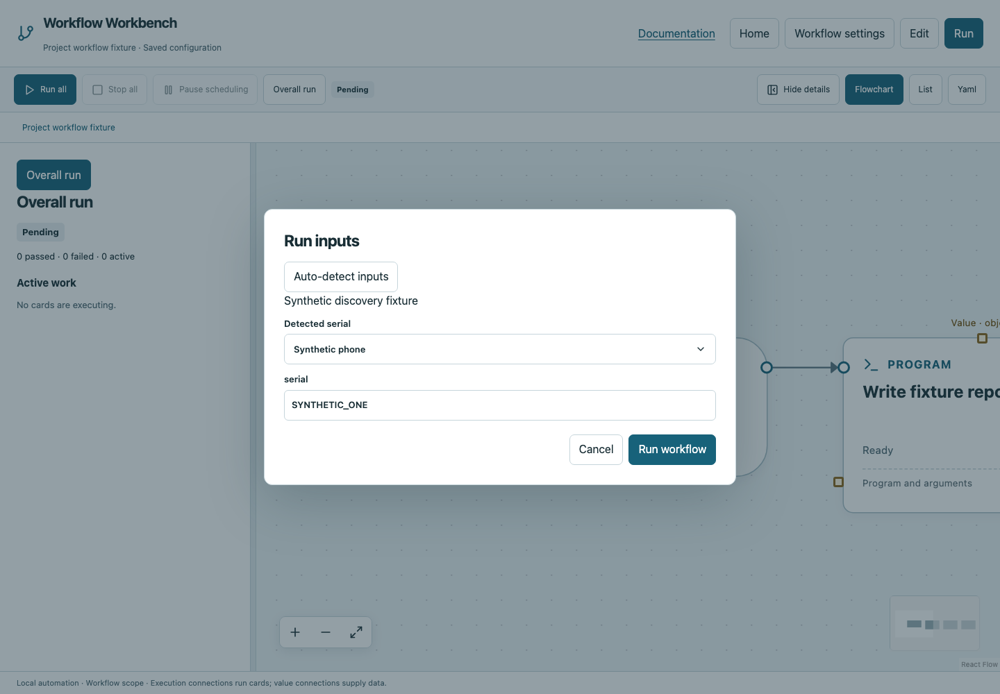
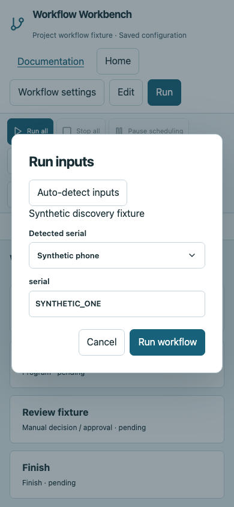

# Settings, resources and secrets

## Workflow settings

Open **Workflow settings** to configure the name, concurrent operation budget, workflow inputs, declared globals, functions, environment and secrets. The YAML reference describes additional source fingerprint patterns. Settings are saved with the workflow; the runtime does not obtain them from a CMS or hosted account.

| YAML field | Meaning and default |
|---|---|
| version | Required schema version `3` |
| name | Human-readable workflow name |
| concurrency | Shared operation budget; default `4`, allowed 1–64 |
| inputs | Named typed inputs; optional default/description |
| globals | Typed run variables with required initial values |
| functions | Named signatures and dedicated graph references |
| graphs | Main/function cards and connections |
| layout | Optional positions/areas; presentation only |
| environment | String environment overrides; default no explicit overrides |
| secrets | Environment names whose values must be masked |
| source_paths | Relative source globs included in resume fingerprints |
| workspace | Execution root relative to the YAML directory; default `.` |
| input_detection | Optional explicit discovery command and timeout |
| report_paths | Workspace-relative report globs; default none |

Declare globals before Get/Set/Update. A global cannot be Void. Function inputs/intermediate results are isolated, but functions share the current run's globals. The [variables](tutorials/variables.md) and [functions](tutorials/functions.md) tutorials show the exact UI sequence.


## Per-card execution settings

Select an executable card and expand **Advanced execution settings**. The field **Timeout, locks, retries and environment** is a JSON object, not separate named switches. For example, enter `{"timeout":60,"resources":["test-device"]}`. Empty settings use defaults. Structural cards coordinate children and do not occupy operation slots: put resource/exclusive/interactive settings on their actual child operations. Do not add retry to manual or structural cards.

| Setting | JSON/YAML key | Behavior |
|---|---|---|
| Timeout | timeout | Optional positive operation deadline. Python/Program/Bash/Script default process limit is 3,600 seconds; HTTP defaults to 30. Loop/Poll use their dedicated configured limits. |
| Resources | resources | Array of resource names, e.g. `["test-device"]`. Operations needing the same resource serialize. |
| Interactive desktop operation | interactive | Default false. Adds the shared `desktop` lock; it does not make the command headless. |
| Exclusive execution | exclusive | Default false. Waits for other operations to finish and blocks new operation scheduling while active. |
| Working directory | cwd | Default resolved workspace (`.`); resolved directory must remain inside that workspace. |
| Environment | environment | Per-card string overrides on the run environment. |
| Expected seconds | expected_seconds | Optional positive estimate for UI progress/ETA, not measured completion. |
| Retry | retry | Default off; eligible operations only. See below. |

These fields are JSON/YAML values where applicable; resources are an array, not a comma-delimited shell string. The compiler rejects scheduling settings on containers that cannot honor them. An External workspace shares the parent coordinator, so its operations also consume the same budget.

## Retry deliberately

```yaml
settings:
  retry:
    attempts: 3
    delay: 1
    backoff: 2
    errors_contain: [temporarily unavailable]
```

`attempts` includes the first try (minimum 1). `delay` is the initial wait in seconds; `backoff` multiplies later waits. `errors_contain` optionally restricts retries to matching literal failure substrings. Without that filter, eligible failures may retry up to the count. Cancellation and manual evidence are never automatically retried. Logs preserve original attempts.

Python, Bash, Script, Program, HTTP, Check path, Read file and Write file support retry. Ensure repeats are safe: retrying a successful external request after an ambiguous timeout can duplicate side effects. Use Try/Catch for explicit recovery and idempotent operations for retries.

## Environment and credentials

Environment values can be inherited from the serving terminal and overridden in the workflow or card. A reference `{$ref: 'env:DEMO_TOKEN'}` reads a value without inserting it directly into stored configuration. Declare `DEMO_TOKEN` under Secret environment names before using it in sensitive headers/inputs.

```yaml
secrets: [DEMO_TOKEN]
```

Declared literal secret values are masked in persisted evidence, including card environment overrides and text split across log chunks. Masking does not make YAML containing credentials safe to publish. Use synthetic values in examples. Generated/transformed secrets cannot automatically be inferred merely from their origin; avoid printing them.

## Source identity and outputs

Use `source_paths` for project source files whose changes should invalidate resume, such as `scripts/**/*.py`. Configuration, supplied inputs and declared source contents participate in fingerprints. Canvas layout does not. A matching fingerprint lets resume reuse evidence; it does not prove a remote system has not changed.

For exact YAML structures see the [configuration reference](../configuration.md). For practical coordination see [Parallel/Join](tutorials/parallel.md) and [running](running.md).

## Workflows in nested project folders

`workspace` selects the execution root relative to the YAML file's directory; omit it for the YAML directory. For example, a YAML under `workflows/test` can use `workspace: ../..` to run from its project root. File operations and per-card `cwd` remain inside the resolved workspace. External workspace paths resolve from the parent's execution root; each child then resolves its own declared workspace relative to its YAML directory. Opening a folder does not execute workflows.

Use `{$ref: 'runtime:python'}` for the Python interpreter running Workbench. The value picker labels it **Workbench Python executable**; Program also has **Use Workbench Python** to select it as its executable. Each Program argument is a separate string or typed string reference. No shell substitution occurs.

## Discover workflow inputs

For declaration, required/default values, passing inputs, a complete detector contract and downloadable example, follow [Run inputs and automatic discovery](inputs.md).

Configure **Workflow settings → Input discovery and report files → Input discovery command**:

```yaml
input_detection:
  argv:
    - {$ref: 'runtime:python'}
    - scripts/detect_inputs.py
  timeout: 30
```

The command runs only after **Run inputs → Auto-detect inputs**. Treat it as trusted local configuration and write discovery commands to be read-only. It must print one JSON object: each declared input name maps to an array of candidates such as `{"value":"example","label":"Example device","automatic":true}`. A `warnings` array contains explanatory strings. Values must match input types; decimal PID strings may become numbers for numeric inputs.

One candidate with `automatic: true` is selected automatically. Multiple candidates remain unselected until you choose; warnings and manual editing remain available. The timeout defaults to 30 seconds and is capped at 120. Detection is disabled during execution and never supplies manual approval evidence.

## Attach suite reports

Declare workspace-relative glob patterns under `report_paths`, editable in Workflow settings. Absolute paths, `..` traversal and symlink escapes are rejected. Only matching files updated during the run appear under **Report files** in the run panel.

```yaml
report_paths:
  - coverage/tests/**/*.json
  - coverage/tests/**/*.html
  - coverage/tests/**/*.log
```

Up to 1,000 matching files are listed. Small text reports are snapshotted into run attachments with declared secrets masked, keeping saved HTML/JSON evidence usable after restart. Snapshots accept JSON, HTML, log, text and CSV files, at most 16 MiB each and 64 MiB total per run. Larger/binary artifacts remain in the workspace and retain a reference. Links to live HTML reports use an isolated browser sandbox. Review report contents before sharing.

## Large command logs

Program stdout/stderr continue streaming to complete disk logs beyond 1 MiB. The returned result retains at most 512 KiB from the end of each stream and includes `truncated`, `stdout_truncated`, `stderr_truncated` and per-stream `output_bytes`. JSON capture fails explicitly if stdout was truncated (large stderr logs do not invalidate intact stdout JSON); use a JSON result file for large structured outputs. A large log alone does not fail a successful command. Inline Python's separate structured return channel remains bounded.





## Inspect nested workflows

Select an External workspace card during a run to see its child status, active operation names, forwarded live output and hierarchical events. Child progress is labelled **Child stage** rather than presented as overall completion. **Open child workflow report** opens the child’s saved evidence when available. Stop this job cancels its child subtree as well.
