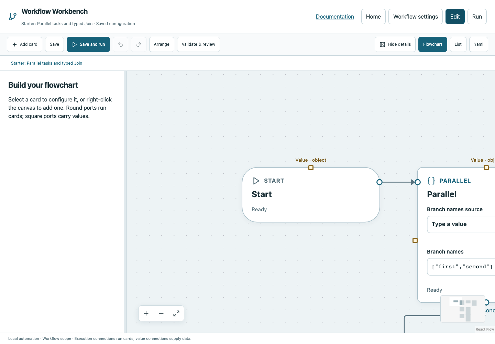

# Parallel tasks and typed Join

The Starter project contains this complete example. Work on a copy in your own folder if you want to preserve a fresh reference. Startup never overwrites an edited Starter file.

## What it demonstrates

**Execution:** Start → Parallel → Join → Finish, with two owned branches.

Each branch has a Python operation and an owned Return. Branches publish independent strings.

## Open and run

1. Choose **Home → Starter** and open **Parallel tasks and typed Join**. Or download [the standalone YAML](../../examples/starter-parallel.yaml) into a dedicated folder and register it.
2. Choose **Edit** and inspect the execution wires and selected card fields. Open any function through its selector or Workflow settings.
3. Inspect each branch’s Return result source and Join’s named typed object. Keep Finish Void unless you deliberately want to publish Join.
4. Save, Validate & review, then Run all. Review declared inputs/manual evidence when prompted.
5. Select operations and completion markers to inspect typed values, logs and event paths. Use Overall run to return to the overview.

## Expected result

Passed; first/second branch results appear in join evidence.



*Captured from the documented downloadable Starter workflow using synthetic data.*

## Terminal use

```bash
workbench validate --config starter-parallel.yaml
workbench run --non-interactive --config starter-parallel.yaml --storage ./evidence
```

For manual, the second command intentionally blocks; use the browser. For poll, prepare ready.txt before a passing noninteractive run, or expect the documented timeout. These examples run in the YAML directory and can write local generated output; keep them isolated.

## Change one thing

Try one small edit, validate it, then compare evidence. A new Run all resets globals and repeats operations; it does not resume a previous run. Reconnect both execution and value sources when changing producers. See [completion markers](../tutorials/completion.md), [values](../values.md), and the [card reference](../cards/index.md) for complete field descriptions.
