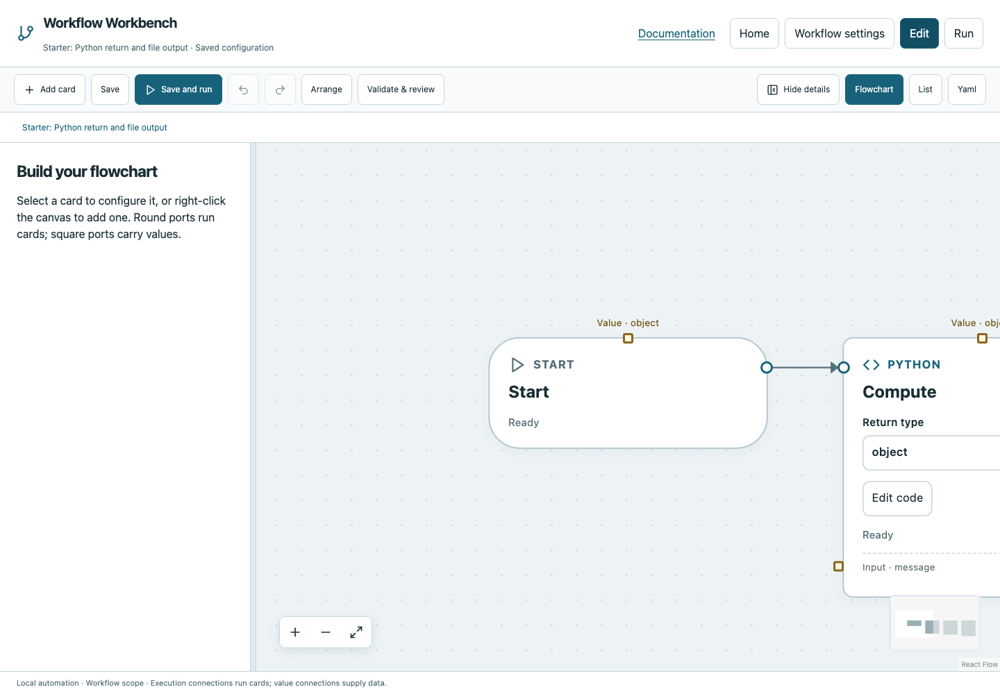

# Python return and file output

The Starter project contains this complete example. Work on a copy in your own folder if you want to preserve a fresh reference. Startup never overwrites an edited Starter file.

## What it demonstrates

**Execution:** Start → Compute → Write → Finish.

Workflow input message is a string with default Hello workflow. Compute receives it through a named input. Write produces output/result.json with overwrite enabled.

## Open and run

1. Choose **Home → Starter** and open **Python return and file output**. Or download [the standalone YAML](../../examples/starter-python.yaml) into a dedicated folder and register it.
2. Choose **Edit** and inspect the execution wires and selected card fields. Open any function through its selector or Workflow settings.
3. Run with the default message, then rerun with a different string in the input dialog. Compare the saved JSON.
4. Save, Validate & review, then Run all. Review declared inputs/manual evidence when prompted.
5. Select operations and completion markers to inspect typed values, logs and event paths. Use Overall run to return to the overview.

## Expected result

Passed; output/result.json contains the message, while finish itself returns void.



*Captured from the documented downloadable Starter workflow using synthetic data.*

## Terminal use

```bash
workbench validate --config starter-python.yaml
workbench run --non-interactive --config starter-python.yaml --storage ./evidence
```

For manual, the second command intentionally blocks; use the browser. For poll, prepare ready.txt before a passing noninteractive run, or expect the documented timeout. These examples run in the YAML directory and can write local generated output; keep them isolated.

## Change one thing

Try one small edit, validate it, then compare evidence. A new Run all resets globals and repeats operations; it does not resume a previous run. Reconnect both execution and value sources when changing producers. See [completion markers](../tutorials/completion.md), [values](../values.md), and the [card reference](../cards/index.md) for complete field descriptions.
