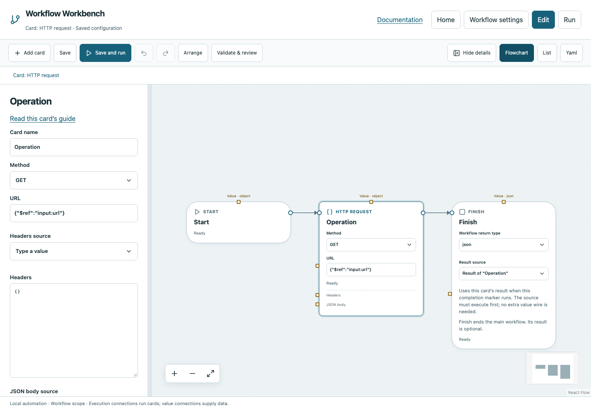

# Call a local service and save its JSON

This example uses only your machine. It demonstrates HTTP response data, a nested value source, JSON output, and reading that file back.

## Prepare the local service

Download [http_fixture.py](../../examples/http_fixture.py) and [http-io.yaml](../../examples/http-io.yaml) into a new directory. The fixture uses Python's standard library and binds only to 127.0.0.1.

```bash
python3 http_fixture.py
```

Leave that terminal open. In another terminal in the same directory, run Workbench and register the YAML. If port 8765 is occupied, start the fixture with `--port 8766` and change the workflow url input to the matching address.

## Follow the cards

1. **HTTP request** performs GET on the workflow input url, default http://127.0.0.1:8765/health.
2. **Write file** selects the request result with nested path `json`, writes output/health.json, uses JSON format and deliberately enables overwrite for reruns.
3. **Read file** parses that JSON back from disk.
4. **Finish** selects Read file's result.



Run all and inspect status 200, response.json, the generated file, then the final returned object: `{"ok":true,"service":"documentation"}`. The raw HTTP response object also includes headers and text, so selecting its nested json field is deliberate.

## Errors to try safely

Stop the local fixture and run again to see connection failure. Call /missing to see non-2xx failure. Disable overwrite and rerun an existing output to see a protected write fail. Re-enable it only for intentional generated output. These failures should not be silently treated as Boolean false.

Use Try/Catch for explicit recovery and an eligible-operation retry policy only when repeats are safe. Stop the fixture with Ctrl+C after the exercise. No external service, credentials or paid account is required.
