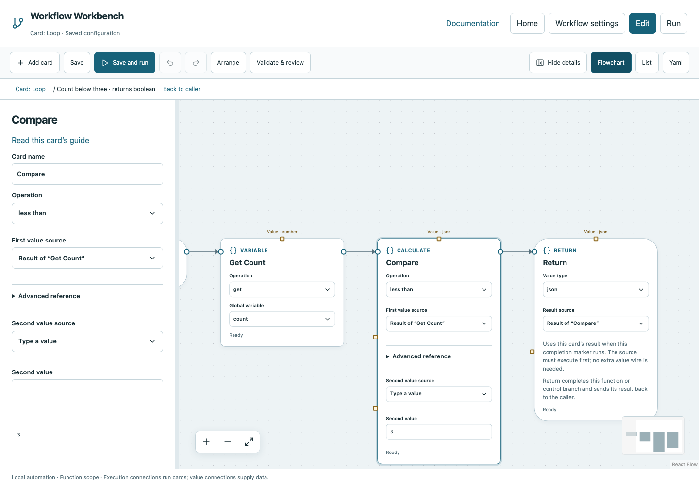

# Declare and use global variables

Use a global when multiple sequential operations need shared state, such as a loop counter. Use function inputs/results when explicit data passing is enough. Globals are typed and live for one run, not permanent settings.

## Create and initialize count

1. Open **Edit → Workflow settings → Global variables**.
2. Enter `count` and choose **Add global variable**.
3. Select type `number` and Initial value `0`.
4. Save. You can also select a Variable card and use **Create / initialize global** to reach the declaration form.

Declaration is required before the card can reference a name. Adding Set/Update does not implicitly create it. The declaration requires an initial value compatible with its type; Void is not a global type.

## Get, Set and Update

| Operation | Configuration | Result |
|---|---|---|
| Get | name count | A copy of current count |
| Set | name count, Value 5 | Stores and returns 5 |
| Update | name count, add, Value 1 | Adds one and returns the new number |
| Update append | array global, Value item | Returns the array with that item appended |

Choose constant values or earlier card results through Value's source picker. Update also supports subtract and multiply. Append requires an array. A number supplied as the JSON string `"1"` is not the numeric value 1.

Download [Variable example](../../examples/variable.yaml). It initializes count to zero, updates it by one and returns one. A second fresh Run all also returns one: globals reset. Resume can replay declared transitions from matching saved evidence; it is not the same as a new run.

## Compare a previous result by name

After a Get card, add Calculate. Select `less_than`, choose **Result of “Get Count”** for First value, and type `3` for Second value. The comparison is Boolean. Inside a function, return it to a While/If condition.

## Scope and concurrency

Called functions share the current run's globals, while their inputs/intermediate results stay isolated. External workspace workflows initialize separate globals; changing count in a child does not overwrite the parent.

Parallel read/read is allowed. A branch writing a global while another reads or writes it is rejected, including access through called functions. Do not use shared mutation to merge concurrent work. Return named branch outputs through Join, then update state after the join if needed.

Read [Loop](../cards/loop.md) and the [While starter](../starters/while.md) for a complete counter workflow.
